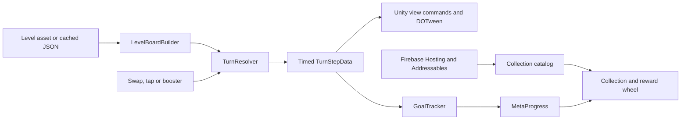

# Circus Match

A circus-themed, swap-based match-3 game for Android, built in Unity 6 (C#).

<table>
  <tr>
    <td></td>
    <td></td>
  </tr>
  <tr>
    <td></td>
    <td></td>
  </tr>
  <tr>
    <td></td>
    <td></td>
  </tr>
  <tr>
     <td></td>
    <td></td>
  </tr>
</table>

## Features

- Swap-based match-3 with Rockets, TNT, Propellers and Light Balls, plus all ten special-piece pairs and chain reactions.
- Layered boards with holes, boxes, locks, 2×2 cages, grass and collectible toys. Goals and move budgets vary by level.
- Hammer, Row, Column and Shuffle boosters. Shuffle resolves any matches and special pieces it leaves behind.
- Win and lose screens, a one-time extra-moves option, a reactive circus mascot, sound and haptics.
- A star-powered reward wheel with boosters, stars and three-card packs. Collection unlocks after completing level 10. Duplicate cards give one star and completed sets award three of each booster.

## Campaign and level tools

| Content | Delivery |
| --- | --- |
| Levels 1–50 | Bundled Unity assets referenced by [LevelCatalog](Assets/Data/VisualConfig/LevelCatalog.asset) |
| Levels 51–100 | Revisioned JSON served by Firebase Hosting and cached on the device |
| Cards | One eight-card set, shipped as a local fallback and also available through the remote Addressables catalog |

Open **Match3 → Level Editor** to paint the cell, overlay and floor layers, set goals, moves and star thresholds, validate, play or export a level as JSON. Open **Match3 → Level Generator** to create seeded layouts with optional mirroring and bot-assisted difficulty tuning.

The editor uses the same level rules and turn resolver as the game. A seeded bot samples candidate moves on board copies, runs playtests and reports win rate, move and star thresholds, and the goals most often left unfinished. Bot results guide tuning and are separate from human playtests.

## Architecture

The **Core** assembly contains the board, match rules, special and booster registries, and turn simulation in plain C#. **LevelAssembly** handles board definitions, validation, generation, goal tracking and the bot. **Presentation** translates the resolved turn into Unity animation and UI. It also handles scene loading, card delivery and local progression. Piece views, effects and reward icons use pools. The card reveal reuses a scene-placed prefab.

Read the [English architecture guide](docs/ARCHITECTURE.md) or the [Turkish architecture guide](docs/ARCHITECTURE.tr.md) for the project layout, authoring workflow and release steps.

## Run locally

1. Open the project in **Unity 6000.4.4f1**. Install Android Build Support to build for a device.
2. Open `Assets/Scenes/Boot.unity` and press Play. During daily editing, use **Addressables → Groups → Play Mode Script → Use Asset Database**.
3. Use **Window → General → Test Runner → EditMode → Run All** to run the test suite. In the Game scene, use **[** and **]** to change levels, **R** to restart and **M** to add moves.

Use a platform-matched Addressables build to test packaged content. For Android, verify on a device. See the [content build and publishing workflow](docs/ARCHITECTURE.md#9-assets-and-memory-atlases-and-addressables).

## Performance and release status

The repository contains earlier Android Memory Profiler captures for the [menu](docs/images/memory_menu.png), [gameplay](docs/images/memory_game.png) and [return to menu](docs/images/memory_menu_return.png). These are historical measurements from before the current campaign, remote cards and atlas layout.

Before the Android release build, run a fresh Development Build on a physical device and record **frame time, GC allocations, memory, draw calls and bundle sizes**. Include first and cached launches, multiple Menu → Game → Menu cycles, special effects, collection scrolling and pack reveals. Save the device, build and test settings alongside the results.

Remaining release work includes checking pooled effect resets, adding the second collection set and updating the first set's title, reviewing mobile button sizes, and adding an interstitial after every fifth completed level on return to the menu. The interstitial and Google Play release are planned.
