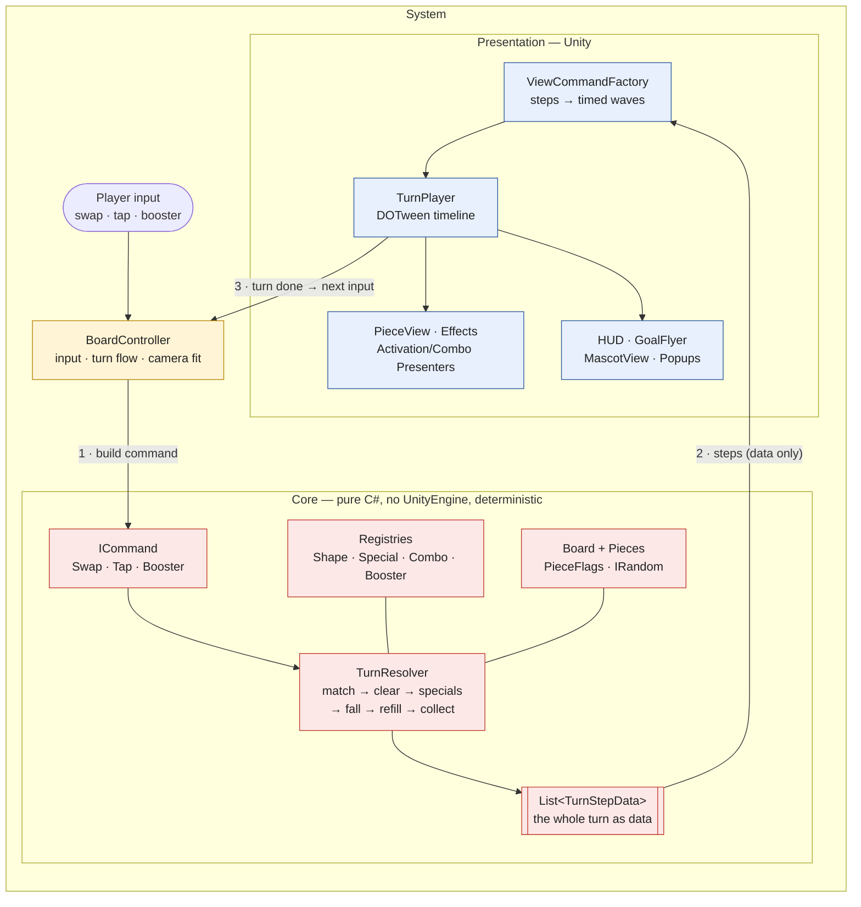

# Circus Match

A circus-themed, swap-based match-3 game for Android, built in Unity 6 (C#).

<table>
  <tr>
    <td></td>
    <td></td>
  </tr>
  <tr>
    <td></td>
    <td></td>
  </tr>
  <tr>
    <td></td>
    <td></td>
  </tr>
  <tr>
     <td></td>
    <td></td>
  </tr>
</table>

## Features

**Matching and special pieces**
- Swipe to swap two pieces. The swap triggers while dragging, no need to release.
- Match 3 or more same-color pieces to clear them.
- Bigger shapes create special pieces at the swapped piece's cell:
  - 4 in a row: Rocket (clears a row or column)
  - 5 in a row: Light Ball (clears every piece of one color)
  - L or T shape: TNT (3×3 blast)
  - 2×2 square: Propeller (clears its neighbors, then flies to a goal target)
- Special pieces chain: a blast that hits another special activates it.

**Combos.** Swapping two specials together creates a combo. All 10 pairs are supported:

| Combo | Effect |
|---|---|
| Rocket + Rocket | Cross (one row and one column) |
| Rocket + TNT | Thick cross (three rows and three columns) |
| Rocket + Propeller | Propeller flies to a target, then fires a rocket |
| Rocket + Light Ball | Turns every piece of one color into rockets |
| TNT + TNT | Large 7×7 blast |
| TNT + Propeller | Propeller flies to a target, then explodes |
| TNT + Light Ball | Turns every piece of one color into TNT |
| Propeller + Propeller | Three propellers |
| Propeller + Light Ball | Turns every piece of one color into propellers |
| Light Ball + Light Ball | Clears the whole board |

**Obstacles and collectibles**
- Box: breaks after several hits from adjacent matches.
- Lock: an overlay on a single cell; the piece underneath can't move until it breaks.
- Cage: a 2×2 overlay that only special pieces can damage (3 hits).
- Grass: a floor layer, cleared by matching or blasting on top of it.
- Holes: cells with no piece, so boards don't have to be rectangular.
- Toy balls: can't be matched or destroyed. Clear the pieces below them so they fall to the bottom of their column, where they are collected.

**Boosters**
- Hammer: breaks a single cell.
- Row and Column: clear a full row or column.
- Shuffle: reshuffles the board.
- Using a booster doesn't cost a move. When a booster runs out, its button shows "+".

**Levels and game flow**
- 20 handmade levels with move limits and goals: collect colors or toys, clear boxes, locks or grass.
- Main menu with a Play button for the next level, and a settings menu for music, sound and vibration.
- Loading screen between scenes.
- Win popup with a 1–3 star rating based on moves left.
- Lose popup with the remaining goals and a one-time +5 moves option.
- Progress and booster counts are saved between sessions.
- In-editor level debugger: jump to any level, restart, add moves.

**Game feel**
- Cleared pieces and goal items fly to their slot in the top panel. Overlays (locks, grass) send a spark instead.
- A reactive mascot cheers big combos and gets worried as moves run out.
- Sound effects with pitch variation and rate limiting, plus haptic feedback.
- The board is fitted between the top and bottom panels on any screen ratio.

## Architecture

The game logic (Core) is pure C# with no Unity references. A turn is fully simulated first, then played back as animation.

A detailed walkthrough (folder map, the life of a move, how to add new content) is in [docs/ARCHITECTURE.md](docs/ARCHITECTURE.md). A Turkish version is in [docs/ARCHITECTURE.tr.md](docs/ARCHITECTURE.tr.md).

**Why this split**
- **Testable:** Core runs in EditMode tests without a scene. A seeded `IRandom` makes every turn reproducible.
- **Simulate, then present:** Core never waits for an animation. The view only reads `TurnStepData`, so timing can change without touching the rules.
- **Open for new content:** new specials, combos and boosters are added as new registry entries. `TurnResolver` doesn't change.

## How it's built

- **Core is plain C#** with no Unity references (`noEngineReferences` assembly). It's deterministic: randomness goes through an `IRandom` interface, so tests and replays are reproducible.
- **Simulate, then present.** One move resolves the whole turn in Core (matches, activations, chains, falls, refills, collected toys) and produces a list of timed steps. The Presentation layer turns those into view commands and plays them back on a DOTween timeline.
- **Data-driven rules.** Piece behavior comes from flags (`Movable`, `CanMatch`, `Locked`, `DamageableByNeighbor`, `DamageableBySpecial`, `Void`, `Collectable`) instead of type checks, so a new obstacle is mostly a new flag combination.
- **Registries instead of switch statements.** Special activations, combos and boosters are looked up by type; each one is its own small class.
- **Levels as data.** A level is a `LevelData`: size, moves, colors, goals and one letter per cell for each board layer (cell, overlay, floor). It is saved as a `LevelAsset` in the project and can be written as JSON for online levels. Each thing you can place (box, lock, cage, grass...) is one `ILevelElement` class with its own placing rules, so the board builder and the validator have no obstacle-specific code. The game only reads levels through an `ILevelSource` interface.
- **Commands for every player action.** Swap, tap and booster use go through the same `ICommand` → `TurnResolver` path.
- **Auto-wired references.** Components find their children, scene objects and assets in `OnValidate`, so there is little manual wiring in the Inspector. Shared prefabs and timings live in `GameAssets` and `AnimationSettings` ScriptableObjects.
- **Event-driven UI.** The board controller raises events (turn started, moves changed, level ended); the mascot, HUD and popups listen instead of being called directly.
- **Pooling.** Piece views and particle effects are pooled. Break and hit effects are chosen per piece type and color from a ScriptableObject config.
- **Tested.** 51 EditMode tests cover commands, matching, special activations, combos, floors, toys, boosters, timing fixes, board colors, building a board from level data, the level validator and JSON round trips.

## Performance and memory

All numbers below were measured on an Android phone with the Unity Memory Profiler (development build, connected to the device).

| What changed | Result |
|---|---|
| Menu and Game load as separate Addressables bundles; the menu no longer references game assets | Game textures load only in the Game scene: **19.9 MB** textures in the menu, **33.8 MB** in a level |
| Game bundle is released when returning to the menu | Game textures leave memory again (the only extra after a round is 3 MB of URP 2D lighting tables, created once) |
| Assets shared by the menu, loading screen and game moved to a shared group | **5.7 MB** of duplicated assets removed from the build |
| HDR and MSAA turned off in URP (not needed for a 2D sprite game) | Render textures **51.3 MB → 21.1 MB** |
| Sprite atlases for board, UI and mascot | UI draw calls 17 → 12; board sprites were already cheap under the SRP Batcher |

**Menu**

**In a level**

**Menu after one round (compared with the first menu snapshot)**

**Addressables build report: duplicated assets before and after the shared group**

<table>
  <tr>
    <td></td>
    <td></td>
  </tr>
  <tr>
    <td align="center">Before: 11 duplicated assets</td>
    <td align="center">After: only TextMesh Pro's default font is left</td>
  </tr>
</table>

## Status

The core game and its screens are done: matching, specials and combos, obstacles, toys, boosters, mascot, menus, popups, audio, loading screen and 20 levels. Scenes load through Addressables with sprite atlases, and the game runs on Android devices.

Levels are now data: a separate `LevelAssembly` builds the board from `LevelData`, checks it with a validator, and can read and write JSON. The 20 levels were moved to the new format.

Next:
- A level editor window with automated playtesting, used to build 40–50 levels
- Level data as JSON, downloaded without an app update
- Google Play closed testing, then release
