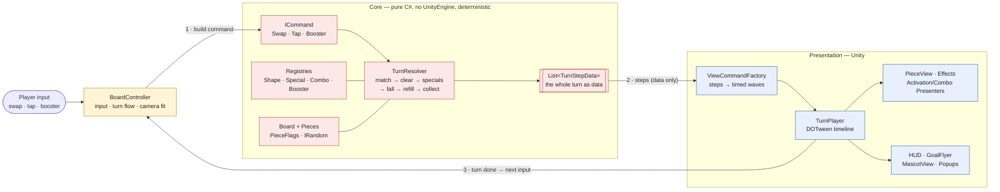

# Match3

A swap-based match-3 game for Android, built in Unity 6 (C#).

<table>
  <tr>
    <td></td>
    <td></td>
  </tr>
  <tr>
    <td></td>
    <td></td>
  </tr>
  <tr>
    <td></td>
    <td></td>
  </tr>
  <tr>
     <td></td>
    <td></td>
  </tr>
</table>

## Features

**Matching and special pieces**
- Swipe to swap two pieces. The swap triggers while dragging, no need to release.
- Match 3 or more same-color pieces to clear them.
- Bigger shapes create special pieces at the swapped piece's cell:
  - 4 in a row: Rocket (clears a row or column)
  - 5 in a row: Light Ball (clears every piece of one color)
  - L or T shape: TNT (3×3 blast)
  - 2×2 square: Propeller (clears its neighbors, then flies to a goal target)
- Special pieces chain: a blast that hits another special activates it.

**Combos.** Swapping two specials together creates a combo:

| | Rocket | TNT | Propeller | Light Ball |
|---|---|---|---|---|
| **Rocket** | Cross | Thick cross | Flies, then fires a rocket | Turns a color into rockets |
| **TNT** | | Large 7×7 blast | Flies, then explodes | Turns a color into TNT |
| **Propeller** | | | Three propellers | Turns a color into propellers |
| **Light Ball** | | | | Clears the whole board |

**Obstacles**
- Box: breaks after several hits from adjacent matches.
- Lock: an overlay on a single cell; the piece underneath can't move until it breaks.
- Cage: a 2×2 overlay that only special pieces can damage (3 hits).
- Grass: a floor layer, cleared by matching or blasting on top of it.
- Holes: cells with no piece, so boards don't have to be rectangular.

**Levels**
- 20 handmade levels with move limits and goals (collect colors, clear boxes, locks, cages or grass).
- Progress is saved between sessions.
- In-editor level debugger: jump to any level, restart, add moves.

## Architecture

The game logic (Core) is pure C# with no Unity references. A turn is fully simulated first, then played back as animation.

**Why this split**
- **Testable:** Core runs in EditMode tests without a scene. A seeded `IRandom` makes every turn reproducible.
- **Simulate, then present:** Core never waits for an animation. The view only reads `TurnStepData`, so timing can change without touching the rules.
- **Open for new content:** new specials, combos and boosters are added as new registry entries. `TurnResolver` doesn't change.

## How it's built

- **Core is plain C#** with no Unity references (`noEngineReferences` assembly). It's deterministic: randomness goes through an `IRandom` interface, so tests and replays are reproducible.
- **Simulate, then present.** One swap resolves the whole turn in Core (matches, activations, chains, falls, refills) and produces a list of timed steps. The Presentation layer turns those into view commands and plays them back on a DOTween timeline.
- **Data-driven rules.** Piece behavior comes from flags (`Movable`, `CanMatch`, `Locked`, `DamageableByNeighbor`, `DamageableBySpecial`, `Void`) instead of type checks, so a new obstacle is mostly a new flag combination.
- **Registries instead of switch statements.** Special activations and combos are looked up by piece kind; each one is its own small class with its own presenter.
- **Gameplay ranges and timings are separate.** Blast sizes live in `ActivationArea`, animation timings in `ActivationTiming`.
- **Pooling.** Piece views and particle effects are pooled. Break and hit effects are chosen per piece type and color from a ScriptableObject config.
- **Tested.** 30 EditMode tests cover commands, matching, special activations, combos, floors and timing fixes.

## Status

The core game is done: matching, all special pieces and combos, obstacles, goals and 20 levels.

Next:
- Menus and screens (level map, win/lose, settings)
- Level data as JSON and a level editor
- Downloading new levels without an app update
- Google Play release
