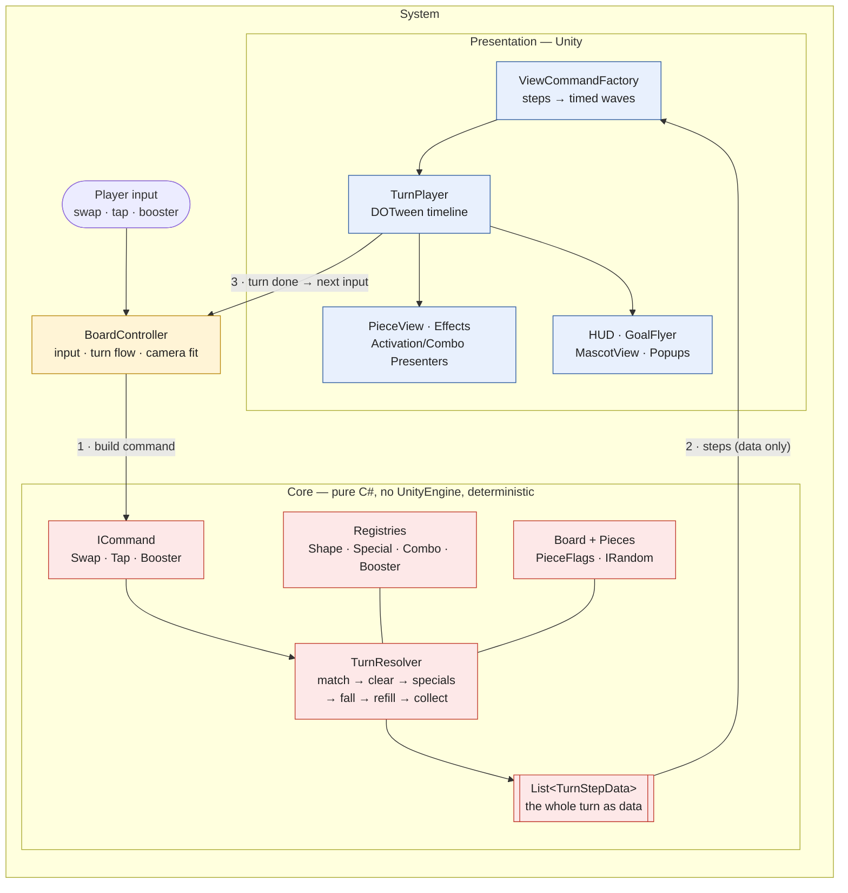

# Circus Match — Architecture Guide

> This guide explains how the project is built: where each file is, and what happens inside the code when the player makes a move. For a short summary, see the [README](../README.md). A Turkish version is in [ARCHITECTURE.tr.md](ARCHITECTURE.tr.md).

## 1. The big picture

The game has two layers. **Core** calculates the rules. **Presentation** shows the result on the screen. The two layers only talk to each other with data.

Think of a football match. **Core is the referee.** It decides if it was a goal, if it was offside, what the score is, and writes the result on a paper. **Presentation is the TV broadcast.** It takes that paper and adds replays, camera angles and crowd sounds. The broadcast can be slow or fancy, but the score does not change. And the referee does not know where the cameras are.

In this project, that paper is a `List<TurnStepData>`: an ordered list of everything that happened in one move.

This split gives three benefits:

- **Testable.** Core never touches Unity, so it can be tested without opening a scene. This is why the 40 tests run in a few seconds.
- **Animations can't break the rules.** Making an animation faster or adding an effect can't change the result of the game.
- **Repeatable.** All randomness goes through `IRandom`. With the same seed, the same move always gives the same result. This makes bot testing possible.

Read the arrows in order: a touch becomes a command, Core calculates the turn, the result goes to Presentation as a data list, and Presentation plays it. When the animation ends, `BoardController` accepts new input.

## 2. Folder map

All code is under `Assets/Scripts`, in two main folders: `Core` (rules) and `Presentation` (screen). To find something, first ask: "Is this a rule, or is this something I see?"

**Core: the game rules (no Unity)**

| Folder | What's inside | Most important file |
| --- | --- | --- |
| `Core/` (root) | Board, goal types, helper logic | `Board.cs`, `LogicLibrary.cs` |
| `Core/Pieces` | Every piece type and its flags | `Piece.cs`, `PieceFlags.cs` |
| `Core/Command` | Player actions: swap, tap, booster | `SwapCommand.cs` |
| `Core/TurnResolveSystem` | The brain that calculates a turn, and the step data | `TurnResolver.cs` |
| `Core/ShapeSystem` | Which shape creates which special piece | `ShapeDefinitions.cs` |
| `Core/SpecialActivation` | Blast areas of special pieces and combos | `ActivationArea.cs` |
| `Core/Booster` | Booster effects | `BoosterRegistry.cs` |
| `Core/RandomSystem` | The randomness interface | `IRandom.cs` |

**Presentation: everything you see on the screen (Unity)**

| Folder | What's inside | Most important file |
| --- | --- | --- |
| `BoardView` | Main classes that build the board, read input and play the turn | `BoardController.cs`, `TurnPlayer.cs` |
| `BoardView/ObstacleSpawners` | Place obstacles at the start of a level | `ObstacleSpawnerRegistry.cs` |
| `Command` | The factory that turns steps into animation commands, and the commands | `ViewCommandFactory.cs` |
| `Presenter` | The animation recipe of each special piece and combo | `ActivationPresenterRegistry.cs` |
| `EffectViews`, `Effects` | Rocket, light beam, explosion, spark, camera shake | `EffectSpawner.cs` |
| `Level` | Level data, goal tracking, HUD, flying icons | `GoalTracker.cs`, `GoalFlyer.cs` |
| `Booster` | Booster buttons and inventory | `BoosterBarController.cs` |
| `Mascot` | Bobo's mood | `MascotView.cs` |
| `Popups` | Win and lose windows | `PopupManager.cs` |
| `Menu`, `Scene` | Main menu, scene change, loading screen | `SceneLoader.cs`, `LoadingScreen.cs` |
| `Setting`, `Audio` | Settings, vibration, sounds | `GameSettings.cs`, `AudioManager.cs` |
| `VisualConfig`, `AnimationConfig` | Visual and timing settings (ScriptableObjects) | `GameAssets.cs`, `AnimationSettings.cs` |
| `Utils` | Helper that finds references automatically | `AutoRef.cs` |

**Important folders outside the code**

- `Assets/Data/Levels`: the 20 level files (`LevelDefinition` assets).
- `Assets/Data/VisualConfig`, `AnimationConfig`: visual and timing settings.
- `Assets/Resources`: files the code loads by name (`AudioConfig`, the `LoadingScreen` prefab). The folder name must be exactly `Resources`.
- `Assets/Prefabs`: piece, cell, effect and UI prefabs.
- `Assets/Scenes`: `Menu` (build index 0) and `Game` (build index 1).
- `Assets/Tests`: Core tests.
- `Assets/Scripts/Editor`: tools that only run in the editor.

## 3. The life of a move

When the player swaps two pieces, Core calculates the whole turn before anything moves on the screen. Then the result is turned into animation and played. Step by step:

1. **A finger touches the screen.** `BoardController.Update()` turns the touch position into a cell with `TurnPlayer.WorldToCell()`.
   - If the finger moves more than half a cell, it is a **swap**. The neighbor in the direction of the move is picked and `TrySwap()` is called. The player doesn't need to lift the finger.
   - If the finger lifts without moving, it is a **tap**. On a special piece, `TryActivate()` is called. If a booster is selected, `TryUseBooster()` is called.
   - If a popup is open, or the last turn is still playing (`TurnPlayer.IsBusy`), the input is ignored.
2. **Checks.** `TrySwap()` checks that both cells are on the board and both pieces can move (not locked, not a hole). If one check fails, nothing happens.
3. **A command is created.** `new SwapCommand(board, x1, y1, x2, y2)`. A tap uses `TapCommand`, a booster uses `BoosterCommand`. A command is a package that says "this is what the player wants to do".
4. **Core calculates the turn.** `TurnResolver.Resolve(board, command)` is called. This one call simulates the whole turn (details in section 4): pieces swap, matches are found, special pieces explode, chain explosions happen, pieces fall, new pieces come, toys are collected. The loop continues until there are no new matches.
   - The result is a `List<TurnStepData>`: an ordered list of everything that happened. Each step has a time in milliseconds.
   - If the swap makes no match, the command is undone (`Undo`) and the list is empty. On the screen, the pieces go and come back.
5. **The result is applied.** `ApplyTurnResult()` takes one move away (not for boosters) and gives the `GoalProgressData` in the list to `GoalTracker`. Goal counts are updated in the data right away.
6. **An event is sent.** The `TurnStarted` event is sent. The mascot listens to it and cheers if the turn was big.
7. **Steps become animation.** `TurnPlayer.PlaySwapTurn()` first plays the swap animation. Then `ViewCommandFactory.Build(steps)` turns the step list into timed animation commands, like "at 0.00 s, pop these pieces" and "at 0.25 s, drop this column".
8. **The animation plays.** `TurnPlayer.PlayCommands()` starts each command at its time. Each command moves pieces with DOTween, spawns effects and plays sounds. Icons of goal pieces fly to the top panel with `GoalFlyer`.
9. **The turn ends.** When the animations finish, `PlayTurnAndCheckShuffle()` checks if there is still a valid move. If not, the board is shuffled. Then `FinishTurn()` checks: are the goals done? Are the moves over?
   - If yes, it waits until all flying icons land, then opens the Win or Lose popup.
   - If no, the player can make the next move.

**The most important rule:** after step 4, the new board is already known. Steps 7 and 8 only show this result. No rules are calculated during the animation.

## 4. The Core layer: home of the rules

There is no Unity in Core: `MonoBehaviour`, `GameObject` and `Vector3` can't be used. The assembly setting (`noEngineReferences`) makes this a hard rule. If someone writes Unity code in Core by mistake, the project doesn't compile.

### The board: `Board`

The board is a grid with three layers. Think of the layers of a cake:

| Layer | What it holds | Access | Example |
| --- | --- | --- | --- |
| Floor | The layer under the piece | `GetFloor(x, y)` | Grass |
| Cell | The piece itself, one per cell | `GetCell(x, y)` | Colored piece, rocket, box, toy, hole |
| Overlay | A layer on top of the piece, can cover more than one cell | `GetOverlayPieceAt(x, y)` | Lock, cage |

- Coordinates: `x` grows from left to right, `y` grows **from top to bottom**. `y = 0` is the top row. Pieces fall in the direction where `y` grows.
- Each piece has a unique `Id` (`board.NextId()`). Presentation finds pieces by this Id, not by position. When a piece falls, its position changes but its Id stays the same.

### Pieces and flags

Every piece comes from the `Piece` class and has: `Id`, `Color`, `Health` (how many hits to break), `GoalKind` (which goal it counts for) and, most important, **`Flags`**.

The rules look at a piece's flags, not its type. The code doesn't ask "is this a box?". It asks "can this piece move?". Most of the time, a new obstacle is just a new mix of flags.

| Flag | Meaning |
| --- | --- |
| `Movable` | Can be swapped and can fall |
| `CanMatch` | Joins matches |
| `DamageableByNeighbor` | Takes damage when a match happens next to it |
| `DamageableBySpecial` | Takes damage from special piece blasts |
| `Locked` | Has a lock or cage on top, can't move |
| `Void` | No piece here, a hole |
| `Collectable` | Is collected when it reaches the bottom of the board |

| Piece | Class | Flags | Health |
| --- | --- | --- | --- |
| Colored piece | `ColoredPiece` | Movable, CanMatch | 1 |
| Special piece (rocket, TNT, propeller, light ball) | `SpecialPiece`, `RocketPiece` | Movable | 1 |
| Box | `BoxPiece` | DamageableByNeighbor | 3 |
| Toy ball | `ToyPiece` | Movable, Collectable | 1 |
| Hole | `HolePiece` | Void | – |
| Lock (overlay) | `LockPiece` | DamageableByNeighbor, DamageableBySpecial | 1 |
| Cage (overlay, 2×2) | `CagePiece` | DamageableBySpecial | 3 |
| Grass (floor) | `GrassPiece` | – | 1 |

### The brain of a turn: `TurnResolver.Resolve()`

This function takes a command, calculates the whole turn and returns a list of steps. In order, it does this:

1. **Check and run the command.** If the swap or booster is not valid, it returns an empty list. If it is valid, `command.Execute()` changes the board.
2. **Two special pieces swapped: combo.** They merge (`ComboMergeData`), and `ComboActivationRegistry` says which combo it is.
3. **Process waiting blasts.** Special pieces that will explode go into a queue (`pending`). They explode one by one. If a blast hits another special piece, that piece is added to the queue too. This is how chain explosions work. `ClearCellsAndEnqueueChains()` does this job.
4. **The match loop.** `MatchLogic.FindMatches()` finds all matches on the board:
   - Matched pieces are cleared. Boxes and locks next to them take damage. Grass under them breaks.
   - Big shapes (4 in a row, 5 in a row, L/T, 2×2) create a new special piece (`SpecialCreatedData`).
   - `AddFillSteps()` makes pieces fall and puts new pieces in empty cells.
   - `TryCollectAtExits()` collects toys that reached the bottom of their column. The empty cell is filled again.
   - If there are new matches, the loop starts again (a cascade). If not, it ends. For safety, it runs at most 100 times.
5. **No match: undo.** If the first round has no match and no special piece exploded, the swap is undone (`Undo`).
6. **Add goal progress.** `GoalProgressData` is added to the end of the list: how many red pieces, boxes, toys and so on in this turn.

### Step data: `TurnStepData`

Each item in the list is a step. Steps only carry data. None of them draws anything.

| Step | What it says |
| --- | --- |
| `ClearPieceData` | These pieces were cleared at this time |
| `DamagePieceData` | This piece took damage, this is its health now |
| `ClearOverlayData` | A lock, cage or grass broke |
| `SpecialCreatedData` | These pieces merged into this special piece |
| `SpecialActivationData` | This special piece exploded and hit these cells |
| `ComboMergeData` | Two special pieces merged |
| `BoosterActivationData` | A booster was used |
| `FallStepData` | These pieces fell from here to there |
| `RefillStepData` | These new pieces came from the top |
| `CollectStepData` | These toys were collected |
| `ShuffleStepData` | The board was shuffled |
| `GoalProgressData` | Goal counts of this turn |

Each hit in a blast step has a time (`HitData.TimeMs`). A rocket going left to right hits each cell a little later. All of these times are in `ActivationTiming.cs`.

### Helper logic: `LogicLibrary.cs`

| Class | Job |
| --- | --- |
| `BoardLogic` | Is the cell valid, can the piece move, where is the column exit (`GetExitY`) |
| `MatchLogic` | Finds matches and the neighbors that will take damage |
| `OrganizationLogic` | Falling (straight and diagonal) and filling with new pieces |
| `SpecialActivationLogic` | Calculates which cells a special piece will hit |
| `MoveLogic` | Is there a valid move on the board, and which one to show as a hint |
| `ShuffleLogic` | Shuffles the board when there are no moves (toys are not moved) |

## 5. Special pieces, combos and boosters: the registry system

Each special piece, combo and booster is its own small class. A **registry** keeps a list that says "for this type, use this class". The code asks the registry instead of using long `switch` blocks.

Think of a restaurant menu. The waiter (`TurnResolver`) doesn't know how to cook the food. He looks at the menu and sends the order to the right cook. To add a new dish, you don't train the waiter. You add one line to the menu and one cook to the kitchen.

| Registry | Key | What it returns | Where |
| --- | --- | --- | --- |
| `ShapeRegistry` | Match shape | Which special piece to create (`ShapeTemplate.Produces`) | `Core/ShapeSystem` |
| `SpecialActivationRegistry` | `PieceKind` | Blast area (`ISpecialActivation`) | `Core/SpecialActivation` |
| `ComboActivationRegistry` | Two `PieceKind`s | Combo effect (`IComboActivation`) | `Core/SpecialActivation` |
| `BoosterRegistry` | `BoosterType` | Cells the booster hits (`IBoosterEffect`) | `Core/Booster` |
| `ActivationPresenterRegistry` | `PieceKind` | Animation recipe of the blast (`IActivationPresenter`) | `Presentation/Presenter` |
| `ComboPresenterRegistry` | Two `PieceKind`s | Animation recipe of the combo | `Presentation/Presenter` |
| `ObstacleSpawnerRegistry` | `ObstacleType` | The class that places the obstacle at level start | `Presentation/BoardView/ObstacleSpawners` |

**Each special piece has two halves.** The Core half (`RocketActivation`) answers "which cells are hit, and when?". The Presentation half (`RocketPresenter`) answers "how does it look on screen?". They don't know each other. Only the `SpecialActivationData` step goes between them.

### Shapes

`ShapeDefinitions.RegisterAll()` defines all shapes as `true/false` grids. Each shape has a **priority**: if the same pieces fit more than one shape, the higher priority wins. So 5 in a row doesn't count as both a 4 and a 5. It only creates a light ball.

| Shape | Creates |
| --- | --- |
| 4 in a row | Rocket (horizontal or vertical, based on the row's direction) |
| 5 in a row | Light ball |
| L or T | TNT |
| 2×2 square | Propeller |

### Combos

`ComboActivationRegistry` sorts the key, so Rocket + TNT and TNT + Rocket are the same entry. All 10 pairs are registered. The light ball's combos with rocket, TNT and propeller use the same class (`LightBallDefaultCombo`): it turns the most common color into that type.

Blast sizes are constants in `ActivationArea.cs` (for example `TntRadius = 1` → 3×3, `TntComboRadius = 3` → 7×7). To change an area, you only change this number.

### Boosters

- **Hammer, Row, Column** work in Core through `BoosterRegistry`. `BoosterCommand` gets the cells to hit from the registry, then uses the same function as special piece blasts (`ClearCellsAndEnqueueChains`). So if a booster hits a special piece, that piece explodes too.
- **Shuffle** doesn't pick a cell. It runs right away when the button is pressed: `BoosterBarController` sends the `InstantBoosterRequested` event, and `BoardController` calls `TurnResolver.ResolveShuffle()`.
- Booster counts are saved in `BoosterInventory` (`PlayerPrefs`). Each booster starts with 3. Using a booster doesn't cost a move.

## 6. The Presentation layer: the game on screen

Presentation takes the step list from Core and turns it into timed animations. It has four main parts.

### `BoardController`: the conductor

It is the center of the Game scene and connects everything:

- **Level start (`Start`):** gets the level from `LevelCatalog` using `LevelProgress.CurrentIndex`, creates the `Board`, places pieces and obstacles, sets up `GoalTracker` and the HUD, and fits the camera to the board.
- **Input (`Update`):** turns touches into swap, tap or booster (section 3).
- **Turn flow:** creates the command, gives it to `TurnResolver`, applies the result and asks `TurnPlayer` to play it.
- **Hint:** if the player doesn't move for a while, it finds a valid move with `MoveLogic` and shows it.
- **End of level:** checks win or lose, opens the popup, calculates stars (`CalculateStars`) and handles the +5 moves continue.
- **Camera (`FitCameraToBoard`):** measures the real edges of the top and bottom panels on screen and fits the board in the space between them. On every screen ratio, the board stays clear of the panels.
- **Events:** `TurnStarted`, `MovesChanged`, `HintShown`, `LevelEnded`, `LevelResumed`. Parts like the mascot listen to them. `BoardController` doesn't know the mascot.

### `TurnPlayer`: the stage director

- Keeps the on-screen version of each piece (`PieceView`) in a dictionary by Id: `GetView(pieceId)`. Steps describe pieces by Id, so this is how the right visual is found.
- Converts between cells and world positions: `CellToWorld(x, y)` and `WorldToCell(pos)`.
- Keeps piece visuals and effects in a pool. A cleared piece is not destroyed. It goes back to the pool and is used again for a new piece. This reduces garbage collector (GC) stutters on mobile.
- Plays the turn (`PlaySwapTurn`, `PlayTapTurn`, `PlayShuffleTurn`). While it plays, `IsBusy` is true and new input is not accepted.

### `ViewCommandFactory`: the timeline builder

It turns the step list into `(start time, animation command)` pairs. It works like a film editor: it decides which scene starts at which second.

A turn moves forward in **waves**. One wave works like this:

1. **Hits.** Blasts and clears are placed with the milliseconds from Core: `At(timeMs) = wave start + timeMs / 1000`. Pieces hit at the same time are grouped into one `ClearPiecesViewCommand`. Each hit updates "when was the last hit" with `MarkHit`.
2. **Fall.** A short time after the last hit (`FallDelay`), pieces start to fall and new pieces come (`FallViewCommand`, `RefillViewCommand`).
3. **The wave ends.** When the longest fall ends, the next wave (cascade) starts from there (`EndWave`).

Result: first the blasts finish, then the pieces fall, then new matches explode. Everything happens in order, without overlapping.

### Animation commands: `IViewCommand`

Each command has two members: `Execute()` (start the animation) and `Duration` (how long it takes). `TurnPlayer.PlayCommands()` puts all of them into one DOTween `Sequence` as callbacks that run at their time, and waits for the sequence to finish.

| Command | What it does |
| --- | --- |
| `ClearPiecesViewCommand` | Pops pieces, plays effects and sounds |
| `DamageViewCommand` | Damage animation on a box or lock |
| `FallViewCommand`, `RefillViewCommand` | Drops pieces, brings new ones from the top |
| `SpawnSpecialViewCommand`, `MergeToAnchorViewCommand` | Pieces merge into a special piece |
| `RocketFlyViewCommand`, `PropellerFlyViewCommand`, `TntExplosionViewCommand`, `LightBeamStartViewCommand`... | Special piece blast shows |
| `HammerStrikeViewCommand` | Hammer hit |
| `CollectViewCommand` | A toy jumps and flies to its goal |
| `ShuffleViewCommand` | The board shuffles |
| `ShakeViewCommand` | The camera shakes |

The factory doesn't write special piece shows itself. It gets the right presenter from `ActivationPresenterRegistry` and asks it for commands (section 5).

### Visual settings

- **`GameAssets`** (ScriptableObject): all prefab references and the level catalog in one place.
- **`AnimationSettings`**: timings like fall speed, pop duration and flight duration. To tune the game feel, you change this, not the code.
- **`*VisualConfig`**: sprites of pieces, boxes, cages, locks and grass, and break effects.
- **`AutoRef`**: classes find their own children by name (`AutoRef.Child<T>(this, "ui_text_moves")`), scene objects (`AutoRef.InScene<T>()`) and assets (`AutoRef.Asset<T>()`) in `OnValidate`. There is almost no manual drag and drop in the Inspector. Because of this, **object names matter**: if you rename an object, the reference breaks and the Console shows an `[AutoRef] ... not found` warning.

## 7. Levels, goals and HUD

A level is a ScriptableObject that holds the board size, move limit, goals and obstacle positions. Goals are updated in the data right away, and on the screen when the icons arrive.

### Level data

| File | What it holds |
| --- | --- |
| `LevelDefinition` | `Width`, `Height`, `MoveLimit`, `Goals` list, `Obstacles` list |
| `LevelGoal` | Goal type (`GoalType`), color (only for color goals), target count |
| `ObstaclePlacement` | Obstacle type and which cells it goes on |
| `LevelCatalog` | The ordered list of all levels. Fills itself from the `Data/Levels` folder |
| `LevelProgress` | Which level the player is on (`CurrentIndex`) and their stars (`PlayerPrefs`) |

Goal types (`GoalType`): `CollectColor` (collect a color), `ClearBox` (break boxes), `ClearLock` (break locks), `ClearGrass` (clear grass), `CollectToy` (collect toys).

At level start, obstacles are placed with `ObstacleSpawnerRegistry`. Holes, boxes and toys are placed before the pieces (they fill the cell itself). Locks, cages and grass are placed after the pieces (they go on top of or under a piece). `ObstacleSpawnPhase` sets this order.

### `GoalTracker`: the goal accountant

- Takes the `GoalProgressData` at the end of each turn (`ApplyProgress`) and lowers the remaining counts. `IsComplete()` says if all goals are done.
- It also gives Core a **target priority** (`ITargetPriority.GetPriority`). The propeller uses it to pick where to fly. Core doesn't know `GoalTracker`. It only knows the `ITargetPriority` interface.

| Priority | Cell |
| --- | --- |
| 3 | The cell under a toy (clearing it drops the toy); an overlay that only special pieces can break |
| 2 | A box, lock or grass that is a goal |
| 1 | A piece of a color you need to collect |
| 0 | A cell that has nothing to do with the goals (the toy itself is 0, because it can't be broken) |

### HUD and flying icons

- `HudController` manages the level number, moves left and goal slots (`GoalSlotView`) in the top panel.
- When a goal piece is cleared, `GoalFlyer.TryFly()` flies its icon from the piece to its slot. Overlays like locks and grass send a spark (`GoalSpark`) instead of an icon. `GoalIconConfig` says which one sends what.
- The number in the slot goes down when the icon **arrives** (`OnIconArrived`). So the player sees the number drop together with the icon.
- When the level ends, `WaitForFlights()` waits for all icons in the air to land (max 2 s). Then `SyncGoals()` matches the numbers with the data and the popup opens.
- The Canvas uses "Screen Space - Camera" mode and flying icons are drawn at `SortingOrders.Flight`, so they appear in front of the UI.

### The mascot: `MascotView`

Bobo listens to `BoardController`'s events and changes his mood. Nobody tells him "cheer now". He decides by himself.

- **Huge turn** (light ball combo or 25+ pieces) → cheers a lot. **Good turn** (combo, special piece, toy collected or 10+ pieces) → cheers.
- **3 moves left** → worried. **1 move left** → sad.
- Tips his hat on a win, gets sad on a loss. Reacts when a hint is shown. If nothing happens for a long time, he moves on his own.
- All thresholds and sprites are in `MascotConfig`.

## 8. Game flow and screens

The game has two scenes: **Menu** and **Game**. Every change between them goes through `SceneLoader`, with the loading screen.

### The path between screens

1. **The app opens → Menu scene.** It is at index 0 in the build list, so it opens first. `MenuController` brings in the logo and the Play button with animation. The button shows the next level: "LEVEL 7". If there are no levels left, it says "MORE LEVELS SOON" and can't be pressed.
2. **Play is pressed → loading screen → Game scene.** `SceneLoader.LoadGame()` → `LoadingScreen.LoadScene("Game")`.
3. **The game is played.** The loop in section 3 repeats on every move.
4. **Win → Win popup.** Stars are shown. When Continue is pressed, `LevelProgress.CurrentIndex` goes up by one and the game returns to the Menu.
5. **Lose → Lose popup.** The remaining goals are shown. There are two choices:
   - **+5 moves:** the level continues from where it stopped (`ContinueWithExtraMoves`). It can be used once per level. On the second loss, the button is visible but faded and can't be pressed.
   - **Retry:** the Game scene loads again from the start, with the loading screen.

### Star rating

| Moves left (compared to the move limit) | Stars |
| --- | --- |
| 25% or more | 3 |
| 10% or more | 2 |
| Less, or +5 moves was used | 1 |

### Loading screen: `LoadingScreen`

- The prefab is in `Resources/LoadingScreen`. It is not placed in any scene: on the first scene change, the code creates it and keeps it alive between scenes with `DontDestroyOnLoad`.
- Order: the screen fades in like a curtain → the new scene loads in the background (`LoadSceneAsync`) → the bar fills → the scene opens → the curtain fades out.
- It stays on screen for at least 0.6 s, so it doesn't flash on fast loads. Clicks are blocked while loading, and a second load can't start.
- When hidden, its Canvas is fully off, so it costs nothing to draw.

### Popups: `PopupManager`

- A popup opens with a call like `PopupManager.Show<WinPopup>()`. Each popup comes from `PopupView` and uses the same open animation.
- `PopupManager.Awake()` hides all popups when the game starts. So popups can be saved in the scene either open or closed.
- While a popup is open, `IsAnyOpen` is true and `BoardController` ignores touches on the board.

### Settings, sound and vibration

- **The settings menu** is only in the Menu scene. `SettingsDropdownView` slides down the music, sound and vibration buttons when the gear button is pressed. Clicking outside closes it.
- **`GameSettings`** saves each setting in `PlayerPrefs` and sends a `Changed` event when it changes. `SettingToggleView` updates each button's on/off look. It knows which setting a button is from the object's name.
- **`AudioManager`** creates itself the first time it is called and lives between scenes. It reads the sound list from `Resources/AudioConfig`.
  - Sounds play with `AudioManager.Play(SoundId.X)`. 8 channels (AudioSources) are used in turn.
  - The same sound can't play too often (`MinInterval`), and its pitch changes a little each time (`PitchVariation`). When 30 pieces pop at once, you hear a full sound instead of harsh noise.
  - `UIButtonSound` plays a click sound when added to a button.
- **`Haptics.Vibrate()`** vibrates the phone if vibration is on. It is used for combo merges, the light ball and winning.

### Saved data

Everything is saved in `PlayerPrefs`, so it stays when the app closes and opens again:

| Data | Who keeps it |
| --- | --- |
| Current level | `LevelProgress.CurrentIndex` |
| Level stars | `LevelProgress.GetStars` / `SaveStars` |
| Booster counts | `BoosterInventory` |
| Music, sound, vibration | `GameSettings` |

## 9. Tests

There are 40 tests in 6 files under `Assets/Tests/EditMode`. They only test Core, don't open a scene, and finish in a few seconds.

**To run them:** Window → General → Test Runner → EditMode tab → Run All.

| File | Tests | What it checks |
| --- | --- | --- |
| `CoreCommandTests` | 11 | Swap, finding matches (line, L, T, 5 in a row), no match for a staircase shape, neighbor damage given only once |
| `SpecialActivationTest` | 10 | Rocket, TNT, combos, chain explosions, tap to activate, same propeller target with the same seed |
| `BoosterTest` | 6 | Hammer, row, column; hitting a cage, not destroying a toy, rejected on a hole |
| `TimingAndFixesTest` | 5 | Blast times grow with distance, chain delay, a swap with no match returns empty |
| `FloorPieceTest` | 4 | Grass breaks with a match on top of it, doesn't break with a match next to it |
| `ToyPieceTest` | 4 | Toy is collected at the bottom, not affected by a rocket, not collected inside a cage, exit moves up if there's a hole under it |

### How to read a test

Each test has three steps: **set up, act, check.**

1. **Set up:** a small board is drawn with letters. For example, `"RRB"` means red, red, blue in one row. A toy is `O`, a hole is `H`.
2. **Act:** a command is given: `TurnResolver.Resolve(board, new SwapCommand(...))`.
3. **Check:** the returned step list and the board are checked: "was the toy collected?", "did the goal count go up by 1?".

The name also says what is tested: `Toy_HitByRocket_IsNotDestroyed` = "a toy is not destroyed when a rocket hits it".

## 10. Recipes: how to add something new

The real test of an architecture is how easy it is to add new content. None of these recipes need a change in `TurnResolver`.

### A new level

1. In the `Assets/Data/Levels` folder, right click → Create → Match3 → **Level Definition**. Use a number in the name so the order is right (`Level21`).
2. Fill in `Width`, `Height`, `MoveLimit`, `Goals` and `Obstacles` in the Inspector.
3. Right click the `LevelCatalog` asset → **Refresh From Data/Levels**. The new level is added to the list.
4. In the game, jump to that level with `LevelDebugger` and try it.

### A new obstacle

1. **Core:** write a new class under `Core/Pieces`. Pick the right layer: `Piece` if it sits in the cell, `OverlayPiece` if it covers the top, `FloorPiece` if it sits under. Give it flags, health and (if it is a goal) a `GoalKind`.
2. Add a new value to `PieceVisualType`. If it will be a goal, add one to `GoalType` too.
3. **Test:** write a test for its behavior (for example "does a rocket damage it?").
4. **Placing it:** add a value to `ObstacleType`, write a new spawner from `IObstacleSpawner`, and register it in `ObstacleSpawnerRegistry`.
5. **Visuals:** add a `VisualConfig` for its sprites or extend an existing one. If it is a goal, add its icon to `GoalIconConfig`.

If you pick the right flags, the rules for matching, damage, falling and shuffling work on the new obstacle by themselves.

### A new special piece

1. Add a new value to `PieceKind`.
2. Add the shape that creates it to `ShapeDefinitions.RegisterAll()`, with a grid and a priority.
3. Write a class that implements `ISpecialActivation`: it returns which cells it hits and at which millisecond. Register it in `SpecialActivationRegistry`. Put the area size in `ActivationArea` and the timing in `ActivationTiming`.
4. For its combos with other special pieces, write `IComboActivation` classes and register them in `ComboActivationRegistry`.
5. **Visuals:** write a presenter that implements `IActivationPresenter` and register it in `ActivationPresenterRegistry`. Add new `IViewCommand`s if needed. Add the sprite to `SpecialVisualConfig`.
6. Write its tests.

### A new booster

1. Add a new value to `BoosterType`.
2. If the booster picks a cell, write a class that implements `IBoosterEffect` and register it in `BoosterRegistry`. Damage and chain explosions come for free.
3. Add its button and sprite to the booster bar.
4. Write its test.

### A new sound

1. Add a new value to `SoundId` (write the numbers out, don't change the existing ones).
2. Add a row for that id in `Resources/AudioConfig` and drag in the sound file.
3. In code, call `AudioManager.Play(SoundId.NewSound)`.

### Tuning the game feel

- **Speeds and durations** (fall, pop, flight): the `AnimationSettings` asset. You can change it without code, even while the game is running.
- **Blast timings** (rocket delay per cell, chain delay): `ActivationTiming.cs`. These are in Core, so they must pass the tests.
- **Mascot reactions:** `MascotConfig`.

## 11. Glossary

| Term | Meaning |
| --- | --- |
| Core | The C# layer that calculates the game rules, with no link to Unity |
| Presentation | The Unity layer that shows Core's result on screen |
| Command (`ICommand`) | One player action: swap, tap or booster |
| Turn | Everything from a command until the board stops moving |
| Step (`TurnStepData`) | The data of one event in a turn: a clear, a fall, a blast... |
| Cascade | New matches that happen by themselves after pieces fall |
| Wave | One blast + fall cycle in the animation; each cascade is a new wave |
| Flag (`PieceFlags`) | A property that says what a piece can do: can it move, can it match... |
| Overlay | A layer on top of a piece: lock, cage |
| Floor | A layer under a piece: grass |
| Registry | A "for this type, use this class" list; used instead of `switch` |
| Presenter | The animation recipe of a special piece or combo |
| View command (`IViewCommand`) | One animation that starts at a set time |
| Pool | Keeping cleared visuals to use them again, instead of destroying them |
| Deterministic | Giving the same result every time with the same input |
| `IRandom` / seed | The randomness interface; the same seed gives the same random numbers |
| Target priority (`ITargetPriority`) | Which cell a targeting piece, like the propeller, will pick |
| Exit | The lowest cell without a hole in a column; a toy is collected when it gets here |
| ScriptableObject | A Unity asset file that holds settings without changing code (levels, configs) |
| `AutoRef` | A helper that finds references automatically by object name |
| Event | A class announcing "this happened"; listeners give their own reaction |
