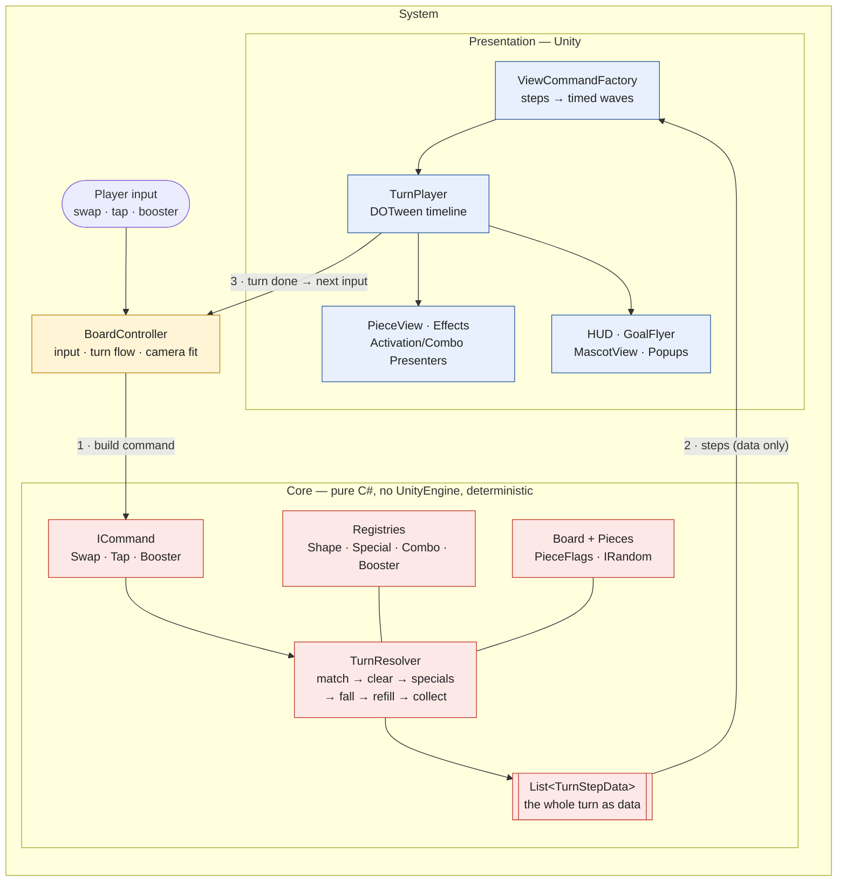

# Circus Match — Mimari Rehberi

> Projenin mimarisini, dosyaların yerini ve bir hamlenin sistem içindeki yolculuğunu anlatan Türkçe rehber. Kısa özet için [README](../README.md). İngilizce sürümü: [ARCHITECTURE.md](ARCHITECTURE.md).

## 1. Büyük resim

Oyun iki ayrı katmandan oluşur: **Core** oyunun kurallarını hesaplar, **Presentation** bu hesabı ekranda oynatır. İkisi birbirine sadece veri ile konuşur.

Bir futbol maçı düşün. **Core hakemdir**: gol oldu mu, ofsayt var mı, skor kaç, hepsine karar verir ve sonucu bir kâğıda yazar. **Presentation televizyon yayınıdır**: o kâğıdı alır, tekrar görüntülerini, kamera açılarını, tezahüratı ekler. Yayın ne kadar yavaş ya da süslü olursa olsun skor değişmez. Hakem de kameranın nerede olduğunu bilmez.

Bu projede o kâğıdın adı `List<TurnStepData>`'dır: bir hamlede olan her şeyin sıralı listesi.

Bu ayrımın üç faydası var:

- **Test edilebilir.** Core, Unity'ye hiç dokunmadığı için sahne açmadan test edilir.
- **Animasyon kuralları bozmaz.** Bir animasyonu hızlandırmak ya da efekt eklemek, oyunun sonucunu değiştiremez.
- **Tekrarlanabilir.** Rastgelelik `IRandom` üzerinden gelir. Aynı tohum (seed) verilirse aynı hamle her seferinde aynı sonucu üretir. Bot testleri bu sayede mümkün.

Okları sırayla oku: dokunuş komuta döner, Core turu hesaplar, sonuç bir veri listesi olarak Presentation'a gider ve orada oynatılır. Animasyon bitince `BoardController` yeni girdiyi kabul eder.

## 2. Klasör haritası

Kodun tamamı `Assets/Scripts` altında, iki ana klasörde durur: `Core` (kurallar) ve `Presentation` (ekran). Bir şeyi bulmak için önce "bu kural mı, görüntü mü?" diye sor.

**Core: oyunun kuralları (Unity yok)**

| Klasör | İçinde ne var | En önemli dosya |
| --- | --- | --- |
| `Core/` (kök) | Tahta, hedef türleri, yardımcı mantık | `Board.cs`, `LogicLibrary.cs` |
| `Core/Pieces` | Her taş türü ve bayrakları | `Piece.cs`, `PieceFlags.cs` |
| `Core/Command` | Oyuncu eylemleri: swap, tap, booster | `SwapCommand.cs` |
| `Core/TurnResolveSystem` | Turu hesaplayan beyin ve adım verileri | `TurnResolver.cs` |
| `Core/ShapeSystem` | Hangi şekil hangi özel taşı üretir | `ShapeDefinitions.cs` |
| `Core/SpecialActivation` | Özel taşların ve komboların etki alanları | `ActivationArea.cs` |
| `Core/Booster` | Booster'ların etkileri | `BoosterRegistry.cs` |
| `Core/RandomSystem` | Rastgelelik arayüzü | `IRandom.cs` |

**Presentation: ekranda görünen her şey (Unity)**

| Klasör | İçinde ne var | En önemli dosya |
| --- | --- | --- |
| `BoardView` | Tahtayı kuran, girdiyi alan, turu oynatan ana sınıflar | `BoardController.cs`, `TurnPlayer.cs` |
| `Command` | Adımları animasyon komutlarına çeviren fabrika ve komutlar | `ViewCommandFactory.cs` |
| `Presenter` | Her özel taşın ve kombonun animasyon tarifi | `ActivationPresenterRegistry.cs` |
| `EffectViews`, `Effects` | Roket, ışın, patlama, kıvılcım, kamera sarsıntısı | `EffectSpawner.cs` |
| `Level` | Level verisi, hedef takibi, HUD, uçan ikonlar | `GoalTracker.cs`, `GoalFlyer.cs` |
| `Booster` | Booster butonları ve envanteri | `BoosterBarController.cs` |
| `Mascot` | Maskot tepkileri | `MascotView.cs` |
| `Popups` | Kazanma ve kaybetme pencereleri | `PopupManager.cs` |
| `Menu`, `Scene` | Ana menü, açılış (Boot), sahne geçişi, yükleme ekranı | `Boot.cs`, `SceneLoader.cs`, `LoadingScreen.cs` |
| `Setting`, `Audio` | Ayarlar, titreşim, sesler | `GameSettings.cs`, `AudioManager.cs` |
| `VisualConfig`, `AnimationConfig` | Görsel ve zamanlama ayarları (ScriptableObject) | `GameAssets.cs`, `AnimationSettings.cs` |
| `Utils` | Referansları otomatik bulan yardımcı | `AutoRef.cs` |

**Kod dışındaki önemli klasörler**

- `Assets/Data/LevelAssets`: 50 yerel level dosyası (`LevelAsset` asset'leri, her biri bir `LevelData` tutar).
- `Assets/Data/VisualConfig`, `AnimationConfig`: görsel ve zamanlama ayar dosyaları.
- `Assets/Resources`: kodun adıyla yüklediği dosyalar. Şu an sadece `AudioConfig` burada. Klasör adı birebir `Resources` olmalı.
- `Assets/Sprites`: kullanıldıkları yere göre ayrılmış sprite'lar (`boards`, `particule`, `user_interface/common`, `user_interface/game`, `ringo_sprites`, `backgrounds`) ve sprite atlasları (bölüm 9).
- `Assets/AddressableAssetsData`: Addressables ayarları ve grupları (bölüm 9).
- `Assets/Prefabs`: taş, hücre, efekt ve UI prefab'ları.
- `Assets/Scenes`: `Boot` (build listesindeki tek sahne), ayrıca Addressables ile yüklenen `Menu` ve `Game`.
- `Assets/Tests`: Core testleri.
- `Assets/Scripts/Editor`: sadece editörde çalışan araçlar.

## 3. Bir hamlenin yolculuğu

Oyuncu iki taşı kaydırdığında tur, ekranda tek bir şey kıpırdamadan önce Core'da baştan sona hesaplanır. Sonra hesap animasyona çevrilip oynatılır. Adım adım:

1. **Parmak ekrana dokunur.** `BoardController.Update()` dokunulan dünya noktasını `TurnPlayer.WorldToCell()` ile hücreye çevirir.
   - Parmak yarım hücreden fazla kayarsa bu bir **swap**'tır. Hangi yöne en çok kaydıysa o komşu seçilir ve `TrySwap()` çağrılır. Parmağı kaldırmak gerekmez.
   - Parmak kaymadan kalkarsa bu bir **tap**'tir: özel taşa dokunulduysa `TryActivate()`, booster seçiliyse `TryUseBooster()` çağrılır.
   - Bir popup açıksa ya da önceki tur henüz oynuyorsa (`TurnPlayer.IsBusy`) girdi yok sayılır.
2. **Kontroller yapılır.** `TrySwap()` iki hücrenin tahtada olduğunu, taşların hareket edebildiğini (kilitli değil, delik değil) kontrol eder. Biri geçersizse hiçbir şey olmaz.
3. **Komut oluşturulur.** `new SwapCommand(board, x1, y1, x2, y2)`. Tap için `TapCommand`, booster için `BoosterCommand`. Komut "ne yapılmak isteniyor"un paketidir.
4. **Core turu hesaplar.** `TurnResolver.Resolve(board, command)` çağrılır. Bu tek çağrı bütün turu simüle eder (ayrıntısı bölüm 4'te): taşlar yer değiştirir, eşleşmeler bulunur, özel taşlar patlar, zincirleme patlamalar olur, taşlar düşer, yenileri gelir, toplar toplanır, yeni eşleşme kalmayana kadar döngü devam eder.
   - Sonuç: `List<TurnStepData>`, olan her şeyin sıralı listesi. Her adımın bir zamanı (milisaniye) vardır.
   - Swap eşleşme üretmediyse komut geri alınır (`Undo`) ve liste boş döner. Ekranda taşlar gidip geri gelir.
5. **Sonuç uygulanır.** `ApplyTurnResult()` hamle sayısını bir azaltır (booster'da azaltmaz) ve listedeki `GoalProgressData`'yı `GoalTracker`'a verir. Hedef sayıları veride hemen güncellenir.
6. **Olay yayınlanır.** `TurnStarted` event'i atılır. Maskot bunu dinler ve tur büyükse sevinir.
7. **Animasyona çevrilir.** `TurnPlayer.PlaySwapTurn()` önce iki taşın yer değiştirme animasyonunu oynatır, sonra `ViewCommandFactory.Build(steps)` ile adım listesini zaman damgalı animasyon komutlarına çevirir: "0,00 sn'de şu taşları patlat", "0,25 sn'de şu sütunu düşür" gibi.
8. **Animasyon oynar.** `TurnPlayer.PlayCommands()` komutları zamanı gelince başlatır. Her komut DOTween ile taşları hareket ettirir, efekt çağırır, ses çalar. Patlayan taşlardan hedefe giden ikonlar `GoalFlyer` ile uçar.
9. **Tur kapanır.** Animasyonlar bitince `PlayTurnAndCheckShuffle()` tahtada geçerli hamle kaldı mı diye bakar. Kalmadıysa tahta karıştırılır. Sonra `FinishTurn()`: hedefler bitti mi, hamle bitti mi?
   - Bittiyse uçan ikonların hepsinin varması beklenir, sonra Win ya da Lose popup'ı açılır.
   - Bitmediyse oyuncu bir sonraki hamleyi yapabilir.

**En önemli kural:** 4. adımda Core işini bitirdiğinde tahtanın yeni hali zaten belli. 7. ve 8. adımlar sadece bu sonucu gösteriyor. Animasyon sırasında hiçbir kural hesaplanmıyor.

## 4. Core katmanı: kuralların evi

Core'da Unity yoktur: `MonoBehaviour`, `GameObject`, `Vector3` kullanılamaz. Assembly ayarı (`noEngineReferences`) bunu zorunlu kılar, yanlışlıkla Unity kodu yazılırsa proje derlenmez.

### Tahta: `Board`

Tahta üç katmanlı bir ızgaradır. Bir pastanın katları gibi düşün:

| Katman | Ne tutar | Erişim | Örnek |
| --- | --- | --- | --- |
| Zemin (floor) | Taşın altındaki katman | `GetFloor(x, y)` | Çimen |
| Hücre (cell) | Taşın kendisi, hücre başına bir tane | `GetCell(x, y)` | Renkli taş, roket, kutu, top, delik |
| Üst katman (overlay) | Taşın üstüne kapanan katman, birden fazla hücre kaplayabilir | `GetOverlayPieceAt(x, y)` | Kilit, kafes |

- Koordinatlar: `x` soldan sağa, `y` **yukarıdan aşağı** artar. `y = 0` en üst sıradır. Taşlar `y`'si büyüyen yöne düşer.
- Her taşın benzersiz bir `Id`'si vardır (`board.NextId()`). Presentation taşları konumla değil bu Id ile tanır. Bir taş düştüğünde konumu değişir ama Id'si aynı kalır.

### Taşlar ve bayraklar

Her taş `Piece` sınıfından türer ve şunları taşır: `Id`, `Color`, `Health` (kaç darbede kırılır), `GoalKind` (hangi hedefe sayılır) ve en önemlisi **`Flags`**.

Kurallar taşın türüne değil bayraklarına bakar. Kod "bu bir kutu mu?" diye sormaz, "bu taş hareket edebilir mi?" diye sorar. Yeni bir engel çoğu zaman sadece yeni bir bayrak kombinasyonudur.

| Bayrak | Anlamı |
| --- | --- |
| `Movable` | Kaydırılabilir ve düşebilir |
| `CanMatch` | Eşleşmeye katılır |
| `DamageableByNeighbor` | Yanında eşleşme olunca hasar alır |
| `DamageableBySpecial` | Özel taş patlaması hasar verir |
| `Locked` | Üstünde kilit ya da kafes var, hareket edemez |
| `Void` | Burada taş yok, delik |
| `Collectable` | Tahtanın dibine ulaşınca toplanır |

| Taş | Sınıf | Bayraklar | Can |
| --- | --- | --- | --- |
| Renkli taş | `ColoredPiece` | Movable, CanMatch | 1 |
| Özel taş (roket, TNT, pervane, ışık topu) | `SpecialPiece`, `RocketPiece` | Movable | 1 |
| Kutu | `BoxPiece` | DamageableByNeighbor | 3 |
| Top (oyuncak) | `ToyPiece` | Movable, Collectable | 1 |
| Delik | `HolePiece` | Void | – |
| Kilit (overlay) | `LockPiece` | DamageableByNeighbor, DamageableBySpecial | 1 |
| Kafes (overlay, 2×2) | `CagePiece` | DamageableBySpecial | 3 |
| Çimen (zemin) | `GrassPiece` | – | 1 |

### Turu hesaplayan beyin: `TurnResolver.Resolve()`

Bu fonksiyon bir komut alır ve turun tamamını hesaplayıp adım listesi döner. Sırasıyla şunları yapar:

1. **Komutu doğrula ve uygula.** Swap ya da booster geçersizse boş liste döner. Geçerliyse `command.Execute()` tahtayı değiştirir.
2. **İki özel taş swap edildiyse kombo.** İkisi birleşir (`ComboMergeData`), `ComboActivationRegistry` hangi kombo olacağını söyler.
3. **Bekleyen patlamaları işle.** Patlayacak özel taşlar bir kuyruğa (`pending`) girer. Her biri sırayla patlar. Patlama başka bir özel taşa denk gelirse o da kuyruğa eklenir. Zincirleme patlama böyle olur. Bu işi `ClearCellsAndEnqueueChains()` yapar.
4. **Eşleşme döngüsü.** `MatchLogic.FindMatches()` tahtadaki tüm eşleşmeleri bulur:
   - Eşleşen taşlar silinir, yanındaki kutu ve kilitler hasar alır, altındaki çimen kırılır.
   - Büyük şekiller (4'lü, 5'li, L/T, 2×2) yeni bir özel taş üretir (`SpecialCreatedData`).
   - `AddFillSteps()` taşları aşağı düşürür ve boş yerlere yenilerini koyar.
   - `TryCollectAtExits()` sütunun dibine ulaşan topları toplar. Boşalan yer tekrar doldurulur.
   - Yeni eşleşme kaldıysa döngü başa döner (kaskad). Kalmadıysa biter. Güvenlik için en fazla 100 tur döner.
5. **Eşleşme yoksa geri al.** İlk turda hiç eşleşme çıkmadıysa ve özel taş da patlamadıysa swap geri alınır (`Undo`).
6. **Hedef ilerlemesini ekle.** Listenin sonuna `GoalProgressData` eklenir: bu turda kaç kırmızı taş, kaç kutu, kaç top...

### Adım verileri: `TurnStepData`

Listedeki her eleman bir adımdır. Hepsi sadece veri taşır, hiçbiri bir şey çizmez.

| Adım | Ne anlatır |
| --- | --- |
| `ClearPieceData` | Şu taşlar şu zamanda silindi |
| `DamagePieceData` | Şu taş hasar aldı, kalan canı şu |
| `ClearOverlayData` | Kilit, kafes ya da çimen kırıldı |
| `SpecialCreatedData` | Şu taşlar birleşip şu özel taşı oluşturdu |
| `SpecialActivationData` | Şu özel taş patladı, şu hücreleri vurdu |
| `ComboMergeData` | İki özel taş birleşti |
| `BoosterActivationData` | Booster kullanıldı |
| `FallStepData` | Şu taşlar şuradan şuraya düştü |
| `RefillStepData` | Yukarıdan şu yeni taşlar geldi |
| `CollectStepData` | Şu toplar toplandı |
| `ShuffleStepData` | Tahta karıştırıldı |
| `GoalProgressData` | Bu turun hedef sayıları |

Patlama adımlarındaki her vuruşun bir zamanı vardır (`HitData.TimeMs`). Roket soldan sağa giderken her hücreyi biraz daha geç vurur. Bu zamanların hepsi `ActivationTiming.cs`'te durur.

### Yardımcı mantık: `LogicLibrary.cs`

| Sınıf | İşi |
| --- | --- |
| `BoardLogic` | Hücre geçerli mi, taş hareket edebilir mi, sütunun çıkışı nerede (`GetExitY`) |
| `MatchLogic` | Eşleşmeleri ve hasar alacak komşuları bulur |
| `OrganizationLogic` | Düşme (düz ve çapraz) ve yeni taşlarla doldurma |
| `SpecialActivationLogic` | Özel taşın hangi hücreleri vuracağını hesaplar |
| `MoveLogic` | Tahtada geçerli hamle var mı, ipucu için hangisi |
| `ShuffleLogic` | Hamle kalmayınca tahtayı karıştırır (topları hariç tutar) |

## 5. Özel taşlar, kombolar ve booster'lar: registry sistemi

Her özel taş, kombo ve booster kendi küçük sınıfıdır. Bir **registry** (kayıt defteri) "şu tür için şu sınıfı kullan" listesini tutar. Kod uzun `switch` blokları yerine registry'e sorar.

Bir restoranın menüsü gibi düşün. Garson (`TurnResolver`) yemeğin nasıl yapıldığını bilmez. Menüye bakar, siparişi doğru aşçıya iletir. Yeni bir yemek eklemek için garsonu eğitmezsin, menüye bir satır ve mutfağa bir aşçı eklersin.

| Registry | Anahtar | Kimi döndürür | Nerede |
| --- | --- | --- | --- |
| `ShapeRegistry` | Eşleşme şekli | Hangi özel taşın üretileceği (`ShapeTemplate.Produces`) | `Core/ShapeSystem` |
| `SpecialActivationRegistry` | `PieceKind` | Patlama etki alanı (`ISpecialActivation`) | `Core/SpecialActivation` |
| `ComboActivationRegistry` | İki `PieceKind` | Kombo etkisi (`IComboActivation`) | `Core/SpecialActivation` |
| `BoosterRegistry` | `BoosterType` | Booster'ın vurduğu hücreler (`IBoosterEffect`) | `Core/Booster` |
| `ActivationPresenterRegistry` | `PieceKind` | Patlamanın animasyon tarifi (`IActivationPresenter`) | `Presentation/Presenter` |
| `ComboPresenterRegistry` | İki `PieceKind` | Kombonun animasyon tarifi | `Presentation/Presenter` |

**Her özel taşın iki yarısı vardır.** Core yarısı (`RocketActivation`) "hangi hücreler, hangi zamanda vurulur" sorusunu cevaplar. Presentation yarısı (`RocketPresenter`) "bu ekranda nasıl görünür" sorusunu. İkisi birbirini tanımaz, aralarında sadece `SpecialActivationData` adımı gider.

### Şekiller

`ShapeDefinitions.RegisterAll()` tüm şekilleri `true/false` matrisleri olarak tanımlar. Her şeklin bir **önceliği** vardır: aynı taşlar birden fazla şekle uyuyorsa önceliği yüksek olan kazanır. Böylece 5'li bir sıra hem 4'lü hem 5'li sayılmaz, sadece ışık topu üretir.

| Şekil | Ürettiği |
| --- | --- |
| 4'lü sıra | Roket (sıranın yönüne göre yatay ya da dikey) |
| 5'li sıra | Işık topu |
| L ya da T | TNT |
| 2×2 kare | Pervane |

### Kombolar

`ComboActivationRegistry` anahtarı sıralar: Roket + TNT ile TNT + Roket aynı kayıttır. 10 kombinasyonun hepsi kayıtlı. Işık topunun roket, TNT ve pervaneyle komboları aynı sınıfı (`LightBallDefaultCombo`) kullanır: en yaygın rengi o türe çevirir.

Patlama alanlarının boyutları `ActivationArea.cs`'te sabit olarak durur (örneğin `TntRadius = 1` → 3×3, `TntComboRadius = 3` → 7×7). Bir alanı değiştirmek için sadece bu sayıyı değiştirirsin.

### Booster'lar

- **Hammer, Row, Column** Core'da `BoosterRegistry` üzerinden çalışır. `BoosterCommand` vurulacak hücreleri registry'den alır, sonra özel taş patlamasıyla aynı fonksiyonu (`ClearCellsAndEnqueueChains`) kullanır. Bu yüzden booster bir özel taşa denk gelirse onu da patlatır.
- **Shuffle** hücre seçmez. Butona basılınca hemen çalışır: `BoosterBarController` onu `InstantBoosterRequested` event'iyle bildirir, `BoardController` da `TurnResolver.ResolveShuffle()` çağırır.
- Booster sayıları `BoosterInventory`'de (`PlayerPrefs`) tutulur, her booster 3 adetle başlar. Booster kullanmak hamle harcamaz.

## 6. Presentation katmanı: ekrandaki oyun

Presentation, Core'un ürettiği adım listesini alıp zamanlanmış animasyonlara çevirir. Dört ana parçası vardır.

### `BoardController`: orkestra şefi

Game sahnesinin merkezidir ve her şeyi birbirine bağlar:

- **Level başı (`Start`):** `LevelProgress.CurrentIndex`'e göre `LevelCatalog`'dan level'ı alır, `Board`'u oluşturur, taşları ve engelleri yerleştirir, `GoalTracker`'ı ve HUD'u kurar, kamerayı tahtaya oturtur.
- **Girdi (`Update`):** dokunuşları swap, tap ya da booster'a çevirir (bölüm 3).
- **Tur akışı:** komutu oluşturur, `TurnResolver`'a verir, sonucu uygular, `TurnPlayer`'a oynatır.
- **İpucu:** oyuncu bir süre hamle yapmazsa `MoveLogic` ile geçerli bir hamle bulup gösterir.
- **Oyun sonu:** kazanma ya da kaybetmeyi kontrol eder, popup'ı açar, yıldızı hesaplar (`CalculateStars`), +5 hamle devamını yönetir.
- **Kamera (`FitCameraToBoard`):** üst ve alt panelin ekrandaki gerçek kenarlarını ölçer, tahtayı aradaki boşluğa sığdırır. Her ekran oranında tahta panellerin altında kalmaz.
- **Event'ler:** `TurnStarted`, `MovesChanged`, `HintShown`, `LevelEnded`, `LevelResumed`. Maskot gibi parçalar bunları dinler. `BoardController` maskotu tanımaz.

### `TurnPlayer`: sahne yönetmeni

- Her taşın ekrandaki karşılığını (`PieceView`) Id'siyle bir sözlükte tutar: `GetView(pieceId)`. Adımlar taşları Id ile anlattığı için doğru görsel böyle bulunur.
- Hücre ile dünya koordinatı arasında çeviri yapar: `CellToWorld(x, y)` ve `WorldToCell(pos)`.
- Taş görsellerini ve efektleri havuzda (pool) tutar. Silinen taş yok edilmez, havuza döner ve yeni gelen taş için tekrar kullanılır. Mobilde çöp toplayıcının (GC) takmasını azaltır.
- Turu oynatır (`PlaySwapTurn`, `PlayTapTurn`, `PlayShuffleTurn`). Oynatma sürerken `IsBusy` true'dur ve yeni girdi kabul edilmez.

### `ViewCommandFactory`: zaman çizelgesi yapıcı

Adım listesini `(başlangıç zamanı, animasyon komutu)` çiftlerine çevirir. Bir film kurgucusu gibi çalışır: hangi sahnenin hangi saniyede başlayacağına karar verir.

Tur **dalgalar** (wave) halinde ilerler. Bir dalga şöyle işler:

1. **Vuruşlar.** Patlamalar ve silinmeler, Core'un verdiği milisaniyelerle yerleştirilir: `At(timeMs) = dalganın başı + timeMs / 1000`. Aynı anda vurulan taşlar tek bir `ClearPiecesViewCommand`'da toplanır. Her vuruş `MarkHit` ile "en son vuruş ne zaman" bilgisini günceller.
2. **Düşme.** Son vuruştan kısa bir süre sonra (`FallDelay`) taşlar düşmeye ve yenileri gelmeye başlar (`FallViewCommand`, `RefillViewCommand`).
3. **Dalga biter.** En uzun düşme bitince bir sonraki dalga (kaskad) oradan başlar (`EndWave`).

Sonuç: önce patlamalar biter, sonra taşlar düşer, sonra yeni eşleşmeler patlar. Her şey üst üste binmeden sırayla olur.

### Animasyon komutları: `IViewCommand`

Her komutun iki üyesi vardır: `Execute()` (animasyonu başlat) ve `Duration` (ne kadar sürer). `TurnPlayer.PlayCommands()` hepsini tek bir DOTween `Sequence`'e zamanı gelince çalışacak callback olarak dizer ve dizinin bitmesini bekler.

| Komut | Ne yapar |
| --- | --- |
| `ClearPiecesViewCommand` | Taşları patlatır, efekt ve ses çıkarır |
| `DamageViewCommand` | Kutu ya da kilide hasar animasyonu |
| `FallViewCommand`, `RefillViewCommand` | Taşları düşürür, yenileri yukarıdan getirir |
| `SpawnSpecialViewCommand`, `MergeToAnchorViewCommand` | Taşlar birleşip özel taşı oluşturur |
| `RocketFlyViewCommand`, `PropellerFlyViewCommand`, `TntExplosionViewCommand`, `LightBeamStartViewCommand`... | Özel taşların patlama gösterileri |
| `HammerStrikeViewCommand` | Çekiç darbesi |
| `CollectViewCommand` | Top zıplar ve hedefe uçar |
| `ShuffleViewCommand` | Tahta karışır |
| `ShakeViewCommand` | Kamera sarsılır |

Özel taşların gösterilerini factory doğrudan yazmaz. `ActivationPresenterRegistry`'den ilgili presenter'ı alır ve ondan komut ister (bölüm 5).

### Görsel ayarlar

- **`GameAssets`** (ScriptableObject): tüm prefab referansları ve level kataloğu tek yerde. Ona sadece Game sahnesi referans verebilir (bölüm 9).
- **`AnimationSettings`**: düşme hızı, patlama süresi, uçuş süresi gibi zamanlamalar. Hissi ayarlamak için koda değil buraya dokunursun.
- **`*VisualConfig`**: taş, kutu, kafes, kilit, çimen sprite'ları ve kırılma efektleri.
- **`AutoRef`**: sınıflar `OnValidate` içinde çocuklarını isimle (`AutoRef.Child<T>(this, "ui_text_moves")`), sahnedeki nesneleri (`AutoRef.InScene<T>()`) ve asset'leri (`AutoRef.Asset<T>()`) kendileri bulur. Inspector'da elle sürükleme neredeyse yok. Bu yüzden **obje isimleri önemli**: bir objeyi yeniden adlandırırsan referans kopar ve Console'da `[AutoRef] ... not found` uyarısı çıkar.

## 7. Level verisi, editör araçları ve HUD

`LevelData` tahta boyutunu, renkleri, hamle bütçesini, yıldız eşiklerini, hedefleri ve üç katmanın karakter satırlarını içerir. `LevelAsset` bu veriyi Unity asset'i olarak saklar. `LevelJson` aynı veriyi yayınlanabilir JSON'a dönüştürür. `LevelElements` her karakteri katmanıyla birlikte tanımlar. Örneğin `#` delik, `B` kutu, `O` oyuncak, `L` kilit, `C` kafes ve floor katmanında `g` çimendir. `LevelValidator` satır boyutlarını, yerleşimi ve hedefleri denetler. `LevelBoardBuilder` geçerli veriden Core tahtasını kurar.

### Yerel ve uzak level'lar

Yerel [LevelCatalog](../Assets/Data/VisualConfig/LevelCatalog.asset), 1–50 aralığını sayısal sırayla tutar. Firebase Hosting, 51–100 aralığını [v2 manifesti](../firebase-hosting/public/levels/v2/index.json) üzerinden sunar. Her kayıtta level kimliği, içerik revizyonu, dosya adı ve SHA-256 bulunur.

`RemoteLevelSync` Boot'tan arka planda çalışır. Eksik revizyonları `Application.persistentDataPath/levels-v2` dizinine indirir, hash'leri doğrular ve gerekli dosyalar tamamlanınca yerel manifesti değiştirir. `RemoteAwareLevelSource` önbellek güncellendiğinde yeni manifesti okur. Temiz çevrimdışı kurulumda ilk 50 level, kampanya önceden indirilmişse 51–100 aralığı da oynanabilir.

### Level Editor, Level Generator ve bot

| Araç | İş akışı |
| --- | --- |
| **Match3 → Level Editor** | Level oluştur, kopyala, üç katmanı boyayarak düzenle. Boyut, renk, hamle, yıldız eşiği ve hedefleri ayarla. Kaydetmeden veya dışa aktarmadan önce doğrula. **Play** ile seçili leveli Boot üzerinden aç. |
| **Match3 → Level Generator** | Boyutları, renkleri, taş adetlerini, renk hedefini, simetriyi, seed'i ve hedef zorluğu seç. Geçerli tahtayı asset olarak kaydet ve bot ayarı için editörde aç. |
| **Bot paneli** | Sabit seed'lerle arka planda denemeler yap. Bot, tahta kopyalarında geçerli hamleleri puanlar. Kazanma oranı, hamle ve yıldız önerileri ile en çok geride kalan hedefi raporlar. Uygulamadan önce sonucu incele. |
| **Export JSON** | Doğrulanmış tek bir level dosyası üret. Uzak yayın için manifest kaydını ekle. Yayındaki bir level değişiyorsa içerik revizyonunu ve SHA-256 değerini güncelle. |

### Hedefler ve arayüz

`GoalTracker`, `GoalProgressData` üzerinden kalan hedefleri günceller. Ayrıca `ITargetPriority` üzerinden pervane gibi hedef seçen taşlara öncelik verir. `HudController` level numarasını, hamleleri ve hedef kutularını gösterir. Hedef ikonları `GoalFlyer` ile uçar. Kutudaki sayı ikon varınca güncellenir. Win veya Lose ekranı açılmadan önce kalan uçuşlar beklenir ve HUD sayıları kayıtla eşitlenir. Maskot tepkileri `MascotView` ve `MascotConfig` üzerinden yönetilir.

## 8. Oyun akışı ve ekranlar

Oyun üç sahneden oluşur: **Boot**, **Menu** ve **Game**. Boot sadece oyunu başlatır. Menu ile Game arasındaki her geçiş `SceneLoader` üzerinden ve yükleme ekranıyla yapılır.

### Ekranlar arası yolculuk

1. **Uygulama açılır → Boot sahnesi.** Build listesindeki tek sahne bu. `Boot` Addressables'ı başlatır, yükleme ekranı prefab'ını yükleyip `LoadingScreen.Register()`'a verir, sonra `SceneLoader.LoadMenu()`'yü çağırır.
2. **Menu sahnesi.** `MenuController` logoyu ve Play butonunu animasyonla getirir. Butonda bir sonraki level yazar: "LEVEL 7". Son level bittikten sonra, yeni level'lar gelene kadar son level tekrar oynanır.
3. **Play'e basılır → yükleme ekranı → Game sahnesi.** `SceneLoader.LoadGame()` → `LoadingScreen.LoadScene("Game")`.
4. **Oyun oynanır.** Bölüm 3'teki döngü her hamlede tekrarlanır.
5. **Kazanılır → Win popup.** Yıldızlar gösterilir. Continue'ya basılınca `LevelProgress.CurrentIndex` bir artar ve Menu'ye dönülür.
6. **Kaybedilir → Lose popup.** Kalan hedefler gösterilir. İki seçenek var:
   - **+5 hamle:** level kaldığı yerden devam eder (`ContinueWithExtraMoves`). Level başına bir kez kullanılır. İkinci kayıpta buton görünür ama soluk ve basılamaz.
   - **Retry:** Game sahnesi yükleme ekranıyla baştan yüklenir.

### Yıldız hesabı

| Kalan hamle (baştaki hamleye oranı) | Yıldız |
| --- | --- |
| %25 ve üstü | 3 |
| %10 ve üstü | 2 |
| Daha az, ya da +5 hamle kullanıldıysa | 1 |

### Yükleme ekranı: `LoadingScreen`

- Prefab'ı `LoadingScreen` adresiyle Addressables'ta durur. Hiçbir sahneye konmaz: `Boot` onu yükleyip kaydeder, ilk sahne geçişinde oluşturulur ve `DontDestroyOnLoad` ile sahneler arasında yaşar.
- Sıra: ekran kararan bir perde gibi gelir (fade in) → yeni sahne arka planda yüklenir (`Addressables.LoadSceneAsync`) → bar dolar → sahne açılır → perde kalkar (fade out).
- En az 0,6 sn görünür, böylece hızlı yüklemede yanıp sönmez. Yükleme sürerken tıklamalar engellenir ve ikinci bir yükleme başlatılamaz.
- Gizliyken Canvas tamamen kapalıdır, çizim maliyeti yoktur.
- Bir sahne yüklenemezse (eksik ya da bozuk paket) hata yazar ve takılı kalmak yerine kendini gizler.

### Popup'lar: `PopupManager`

- `PopupManager.Show<WinPopup>()` gibi bir çağrıyla açılır. Her popup `PopupView`'dan türer ve aynı açılış animasyonunu kullanır.
- `PopupManager.Awake()` oyun başlarken tüm popup'ları gizler. Bu yüzden popup'lar sahnede açık ya da kapalı kaydedilebilir.
- Bir popup açıkken `IsAnyOpen` true olur ve `BoardController` tahtaya dokunmayı yok sayar.

### Ayarlar, ses ve titreşim

- **Ayarlar menüsü** sadece Menu sahnesindedir. `SettingsDropdownView` dişli butonuna basılınca müzik, ses ve titreşim butonlarını aşağı kayarak açar. Dışarı tıklayınca kapanır.
- **`GameSettings`** her ayarı `PlayerPrefs`'te tutar ve değişince `Changed` event'i atar. `SettingToggleView` her butonun açık/kapalı görünümünü günceller. Butonun hangi ayar olduğunu obje adından anlar.
- **`AudioManager`** ilk çağrıldığında kendini oluşturur ve sahneler arasında yaşar. Ses listesini `Resources/AudioConfig`'ten okur.
  - Sesler `AudioManager.Play(SoundId.X)` ile çalınır. 8 kanal (AudioSource) dönüşümlü kullanılır.
  - Aynı ses çok sık çalınmaz (`MinInterval`), her seferinde perdesi hafifçe değişir (`PitchVariation`). 30 taş aynı anda patlayınca kulak tırmalayan bir gürültü yerine dolgun bir ses çıkar.
  - `UIButtonSound` bir butona eklenince tıklama sesi çalar.
- **`Haptics.Vibrate()`** titreşim ayarı açıksa telefonu titretir. Kombo birleşmesi, ışık topu ve kazanma anında kullanılır.

### İlerleme, ödül çarkı ve koleksiyon

`MetaProgress`, her levelin yıldız rekorunu, toplam yıldızı, çark birikimini ve haklarını, bekleyen yıldız uçuşlarını, booster bakiyelerini, sahip olunan kart kimliklerini ve ödülü alınan setleri sürümlü JSON olarak `PlayerPrefs`'te saklar. Eski kayıt anahtarları uyumluluk için korunur. Level ilerlemesi ve ses ayarları da `PlayerPrefs` kullanır. Bir levelin yıldız rekoru yükseldiğinde yalnızca fark eklenir. Yıldız uçuşu menü geçişi tamamlanınca başlar.

`WheelService` ağırlıklı bir dilim seçer ve ödülü harcanan çevirme hakkıyla aynı güncellemede kaydeder. Yıldız eşiği yeni çevirme hakkı verir. Booster ödülleri oyun içi envantere eklenir. Koleksiyon sekmesi ve kart paketleri 10. level bitince açılır. Bir paket nadirlik ağırlıklarıyla üç farklı kart çeker. Tekrar eden kart bir yıldız, seti tamamlamak her boosterdan üç tane verir. Set ödülü her set kimliği için bir kez verilir. Koleksiyon kilitliyken veya tüm setler tamamlandığında paket dilimi beş yıldız verir.

`CollectionCatalogSource`, Boot sırasında `collection/catalog` adresini yükler ve başarılı Addressables handle'ını oturum boyunca tutar. Uzak katalog yüklenemezse veya geçersizse gömülü `CollectionCatalog` kullanılır. Çark ve koleksiyon ekranı aynı kataloğu okur. Grid, `CollectionSetView` ve `CollectionCardView` ile iki sütun halinde kurulur. Bulunmamış kartlar kilitli kart görselini kullanır. `CardPackReveal` sahnedeki tek prefab örneğini yeniden kullanır. Yeni kartlar koleksiyon düğmesine, yıldız olan tekrar kartları çark barına uçar. Güncellemelerde kart ve set kimliklerini koru.

## 9. Asset'ler ve bellek: atlaslar ve Addressables

| Grup | Konum | İçerik |
| --- | --- | --- |
| `Scenes` | Yerel | `Menu` ve `Game` aynı sahne grubunda, Pack Together |
| `UI` | Yerel | `LoadingScreen` |
| `Shared` | Yerel | `atlas_ui_common` |
| `Collection Remote` | Firebase Hosting | `collection/catalog` adresindeki `CollectionCatalogRemote` ve bağlı kart sprite'ları |

### Sprite atlasları

- `atlas_ui_common` ortak UI görsellerini, yıldızı ve karıştırma ikonunu içerir.
- `atlas_ui_game` oyun ekranı, `atlas_ui_menu` menü, çark ve koleksiyon için seçilmiş görselleri içerir. Bu üç atlasın packable listesi elle yönetilir.
- `atlas_board` tahta ve partikül klasörlerini, `ringo_sprite_atlas` maskotun sprite grubunu paketler.
- Büyük arka planları ve uzak kart çizimlerini yerel UI atlaslarının dışında tut. Gerçek bağımlılıkları ve tekrarlı asset'leri Build Report'tan kontrol et. Yerel ve uzak katalogların ortak kart görsellerini de incele.

### Build ve yayın

1. Günlük geliştirmede `Boot.unity` ve **Use Asset Database** kullan. **Use Existing Build** ile test etmek için test platformuna uygun paket oluştur. Android shader'ları Windows Editör'de pembe görünebilir. Android paketini telefonda doğrula.
2. Android Build Profile'ı etkinleştir ve sürümü profilin **Player Settings → Version** alanından ayarla. Addressables bu değeri kullanır. Projedeki build script'i tam build sırasında sürümü yeniden okur. APK'daki yerel paketler ve yayınlanan katalog aynı build'e ait olmalı.
3. Android için **Build Profiles → Build And Run** kullan. Sadece içerik üretmek için **Addressables Groups → Build → New Build → Default Build Script** çalıştır. Player build'inde Addressables otomatik derlenir. Build raporunu kontrol et ve o build'in `addressables_content_state.bin` dosyasını sakla.
4. `ServerData/Android` çıktısındaki katalog, hash ve uzak bundle'ları `firebase-hosting/public/addressables/Android` altına ekle. Desteklenen eski sürümlerin katalog ve gerekli bundle dosyalarını koru.
5. `firebase-hosting` içinde `firebase.cmd deploy --only hosting --project circus-royale-levels-host` çalıştır. Komut `public` içindeki level ve Addressables dosyalarını birlikte yayınlar. Mevcut sürüme yalnızca kart içeriği güncellemesi için o sürümün içerik durumuyla **Update a Previous Build** kullan.
6. Yeni katalog ve bundle URL'lerini kontrol et. Telefonda temiz online kurulum, önbellekli ve temiz çevrimdışı açılışları dene. Koleksiyon testi için 10. leveli bitirmiş bir kayıt kullan.

### Android yayın build'i öncesi performans ölçümü

Eski Android ölçümleri [docs/images](images) altında duruyor. Güncel ölçümü fiziksel cihazda Development Build ile tekrarla. Telefon modeli, çözünürlük, sürüm, grafik ayarları ve Profiler seçeneklerini sonuçlarla birlikte kaydet.

| Senaryo | Ölçümler |
| --- | --- |
| Temiz açılış, önbellekli açılış ve çevrimdışı açılış | Menünün hazır olma süresi, level ve katalog erişimi |
| Tekrarlanan Menu → Game → Menu geçişleri | Texture ve render texture belleği, elde kalan nesneler ve kare süresi sıçramaları |
| Kaskadlar, kombolar ve art arda kullanılan efektler | CPU/GPU kare süresi, GC Alloc, draw call ve efektin sıfırlanması |
| Çark, paket açılışı ve Collection kaydırma | Kare süresi, tahsisler ve ilk sprite yükleme maliyeti |
| Android Addressables build'i | Bundle boyutları ve tekrarlı bağımlılıklar |

Unity Profiler, Memory Profiler, uygun olduğunda Frame Debugger ve Addressables Build Report kullan. Güncel sürümün ölçümleri henüz alınmadı.

## 10. Testler

Edit Mode testlerini Unity Test Runner üzerinden çalıştır. Core testleri sahneye ihtiyaç duymaz. Entegrasyon kontrolleri Unity asset ve sahnelerini kullanabilir.

**Çalıştırmak için:** Window → General → Test Runner → EditMode sekmesi → Run All.

| Alan | Kapsam |
| --- | --- |
| Core | Swap, eşleşme şekilleri, özel taş tetikleme ve zamanlama, booster, zemin hasarı ve oyuncak toplama |
| Level | JSON okuma ve yazma, tahta kurma ve doğrulama, düzenleme, üretim ve deterministik bot simülasyonları |
| Meta | Kart sahipliği ve tekrarlar, set tamamlama, çark ödülleri ve kayıtlı ilerleme |

### Bir test nasıl okunur

Her test üç adımlıdır: **kur, yap, kontrol et.**

1. **Kur:** küçük bir tahta harflerle çizilir. Örneğin `"RRB"` bir sırada kırmızı, kırmızı, mavi demektir. Top `O`, delik `H` ile gösterilir.
2. **Yap:** bir komut verilir: `TurnResolver.Resolve(board, new SwapCommand(...))`.
3. **Kontrol et:** dönen adım listesine ve tahtaya bakılır: "top toplandı mı?", "hedef sayısı 1 arttı mı?".

İsim de ne test edildiğini söyler: `Toy_HitByRocket_IsNotDestroyed` = "top rokete vurulunca yok olmaz".

## 11. Tarifler: yeni bir şey nasıl eklenir

Mimarinin asıl testi yeni içerik eklemenin kolaylığıdır. Aşağıdaki tariflerin hiçbirinde `TurnResolver`'ı değiştirmen gerekmez.

### Yeni bir level

1. `Assets/Data/LevelAssets` klasöründe sağ tık → Create → Match3 → **Level Asset**. Sıralama doğru olsun diye numaralı adlandır (`Level-21`).
2. Inspector'da `Data` alanını doldur: boyut, hamle, renkler, `cells` satırları (gerekirse `overlays` ve `floors`) ve hedefler. Her satır tam `width` harf uzunluğunda olmalı.
3. `LevelCatalog` asset'ine sağ tık → **Refresh From Data/LevelAssets**. Yeni level listeye eklenir.
4. Editörde `LevelDebugger` ile doğrudan o level'a atlayıp dene (`[` ve `]` tuşları).

Level Editor penceresi (`Match3 > Level Editor`) 1 ve 2. adımları yapabilir: level'ı bir ızgarada boyarsın, kaydetmeden önce `LevelValidator` kontrol eder, `Export JSON` online host için dosyayı yazar. Aynı pencerideki bot, level'ı sabit tohumlarla oynatıp zorluğunu ölçer.

### Yeni bir engel

1. **Core:** `Core/Pieces` altına yeni bir sınıf yaz. Doğru katmandan türet: hücrede duruyorsa `Piece`, üste kapanıyorsa `OverlayPiece`, altta duruyorsa `FloorPiece`. Bayraklarını, canını ve (hedefse) `GoalKind`'ını ver.
2. `PieceVisualType`'a yeni bir değer ekle. Hedef olacaksa `GoalType`'a da ekle.
3. **Test:** davranışını kontrol eden bir test yaz (örneğin "roket hasar veriyor mu").
4. **Yerleştirme.** Yeni öğeyi `ILevelElement` ile tanımla. `CanPlace`, `Place` ve `AutoGoal` davranışlarını belirt ve öğeyi `LevelElements` kaydına ekle.
5. **Görüntü:** sprite'ları için bir `VisualConfig` ekle ya da mevcut olanı genişlet. Hedefse `GoalIconConfig`'e ikonunu ekle.

Bayrakları doğru seçersen eşleşme, hasar, düşme ve karıştırma kuralları yeni engele kendiliğinden uygulanır.

### Yeni bir özel taş

1. `PieceKind`'a yeni bir değer ekle.
2. Hangi şeklin onu ürettiğini `ShapeDefinitions.RegisterAll()`'a bir matris ve öncelikle ekle.
3. `ISpecialActivation`'ı uygulayan bir sınıf yaz: hangi hücreleri, hangi milisaniyede vurduğunu döner. `SpecialActivationRegistry`'e kaydet. Alan boyutunu `ActivationArea`'ya, zamanlamayı `ActivationTiming`'e koy.
4. Diğer özel taşlarla komboları için `IComboActivation` sınıfları yaz ve `ComboActivationRegistry`'e kaydet.
5. **Görüntü:** `IActivationPresenter`'ı uygulayan bir presenter yaz, `ActivationPresenterRegistry`'e kaydet. Gerekirse yeni `IViewCommand`'lar ekle. Sprite'ı `SpecialVisualConfig`'e ekle.
6. Testlerini yaz.

### Yeni bir booster

1. `BoosterType`'a yeni bir değer ekle.
2. Hücre seçen bir booster'sa `IBoosterEffect`'i uygulayan bir sınıf yaz ve `BoosterRegistry`'e kaydet. Hasar ve zincirleme patlama kendiliğinden gelir.
3. Booster bar'a butonunu ve sprite'ını ekle.
4. Testini yaz.

### Yeni bir sprite

1. Kullanıldığı yere göre doğru klasöre koy: `Sprites/boards` (tahtada), `Sprites/user_interface/game` (oyun arayüzü), `Sprites/user_interface/common` (menü ve oyun), `Sprites/backgrounds` (büyük tek görseller).
2. UI görselini ilgili common, game veya menu atlasına elle ekle. Tahta atlası klasör üzerinden paketlenir.
3. Menü ve oyun ikisi de kullanıyorsa `common` klasöründe olmalı. Sonra Analyze ile kopya kontrolü yap.

### Yeni bir sahne

1. Sahneyi `Scenes` Addressables grubuna ekle ve kısa bir adres ver (örneğin `Shop`).
2. Yeni bir `SceneLoader` metodu üzerinden `LoadingScreen.LoadScene("Shop")` ile yükle. Build listesine ekleme.
3. Addressables içeriğini yeniden derle ve Analyze çalıştır.

### Yeni bir ses

1. `SoundId`'ye yeni bir değer ekle (değerleri açıkça yaz, mevcutların sayısını değiştirme).
2. `Resources/AudioConfig`'e o id için bir satır ekle ve ses dosyasını sürükle.
3. Kodda `AudioManager.Play(SoundId.YeniSes)` çağır.

### Oyun hissini ayarlamak

- **Hızlar ve süreler** (düşme, patlama, uçuş): `AnimationSettings` asset'i. Kod yazmadan, oyun açıkken bile değiştirebilirsin.
- **Patlama zamanlamaları** (roketin hücre başına gecikmesi, zincir gecikmesi): `ActivationTiming.cs`. Bunlar Core'da olduğu için testlerden geçmesi gerekir.
- **Maskot tepkileri:** `MascotConfig`.

## 12. Sözlük

| Terim | Anlamı |
| --- | --- |
| Core | Oyun kurallarını hesaplayan, Unity'ye hiç bağlı olmayan C# katmanı |
| Presentation | Core'un sonucunu ekranda gösteren Unity katmanı |
| Komut (`ICommand`) | Oyuncunun bir eylemi: swap, tap ya da booster |
| Tur (turn) | Bir komutla başlayıp tahta durulana kadar olan her şey |
| Adım (`TurnStepData`) | Turda olan tek bir olayın verisi: silinme, düşme, patlama... |
| Kaskad | Taşlar düştükten sonra kendiliğinden oluşan yeni eşleşmeler |
| Dalga (wave) | Animasyonda bir patlama + düşme döngüsü; her kaskad yeni bir dalgadır |
| Bayrak (`PieceFlags`) | Taşın ne yapabildiğini söyleyen özellik: hareket eder mi, eşleşir mi... |
| Overlay | Taşın üstüne kapanan katman: kilit, kafes |
| Floor | Taşın altındaki katman: çimen |
| Registry | "Şu tür için şu sınıfı kullan" kayıt defteri; `switch` yerine kullanılır |
| Presenter | Bir özel taşın ya da kombonun animasyon tarifi |
| View command (`IViewCommand`) | Belli bir zamanda başlayan tek bir animasyon |
| Pool (havuz) | Silinen görselleri yok etmek yerine saklayıp tekrar kullanmak |
| Deterministik | Aynı girdiyle her seferinde aynı sonucu üretmek |
| `IRandom` / seed | Rastgelelik arayüzü; aynı seed aynı rastgele sayıları verir |
| Hedef önceliği (`ITargetPriority`) | Pervane gibi hedef seçen taşların hangi hücreyi seçeceği |
| Çıkış (exit) | Bir sütunun en alttaki deliksiz hücresi; top buraya gelince toplanır |
| ScriptableObject | Unity'de kodu değiştirmeden ayar tutan asset dosyası (level'lar, config'ler) |
| `AutoRef` | Referansları obje ismiyle otomatik bulan yardımcı |
| Event | Bir sınıfın "şu oldu" diye duyurması; dinleyenler kendi tepkisini verir |
| Addressables | Asset'leri adresle, paketlerden ve sadece gerektiğinde yükleyen Unity sistemi |
| Bundle (paket) | Birlikte yüklenen ve birlikte boşaltılan asset grubu |
| Sprite atlas | Birçok küçük sprite'ın tek bir texture'a paketlenmiş hali |
| Boot sahnesi | Addressables'ı başlatıp menüyü açan, neredeyse boş ilk sahne |
